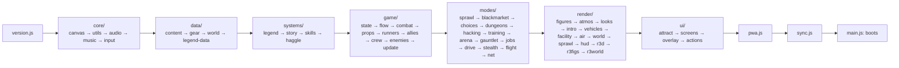
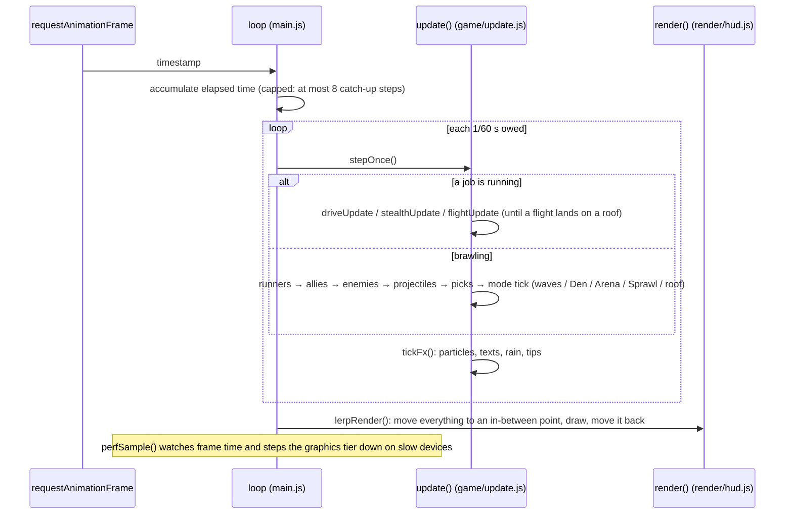
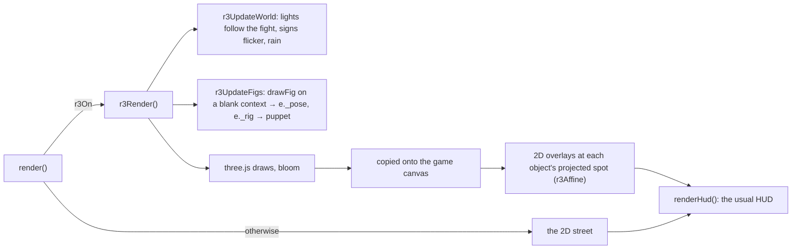
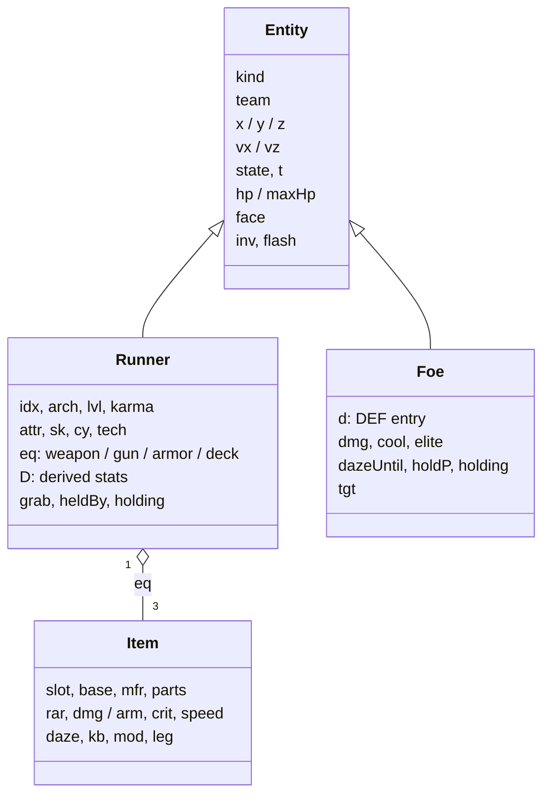

# Architecture

Plain JavaScript drawing on a `<canvas>`, with HTML menus over it. There's no framework and no runtime dependency. `index.html` loads one stylesheet and 49 small **classic scripts** (not modules), in order, into **one shared global scope**. The rule that keeps this sane is that a file may only use, *at load time*, what files above it defined. At run time anything can call anything.

## Folder layout

| Path | What lives there |
|---|---|
| `index.html` | The page, the `BUILD:SCRIPTS` list (the one place the load order is defined), meta and link-preview tags |
| `src/js/core/` | Platform: canvas and frame loop, utils and storage (`store`, `prefs`), audio, music, input (keyboard, pads, touch) |
| `src/js/data/` | Tables only: enemies and districts (`DEF`, `STAGES`), gear (`BASES`, `MFR`, `PARTS`, `RAR`), world (`CYBER`, `TECH`, `CONTRACTS`, `NPCS`, `DIFF`), legend data |
| `src/js/systems/` | Cross-mode systems: legend (feats, legendaries, Codex), story scenes, skill trees, haggling |
| `src/js/game/` | The simulation: state, flow between places, combat, props and grabs, runners, allies and crew, enemies, the update step |
| `src/js/modes/` | Mode rules: Sprawl, black market, choices, dungeons, hacking, training, Arena, the Gauntlet, jobs (driving, drone, flight), online co-op |
| `src/js/render/` | Drawing: figures and weapons, light, enemy looks, boss intros, vehicles, the corp floor, the skyline, backgrounds, the Sprawl street, the HUD and `render()`; the 3D view of street fights (`r3d.js`, `r3figs.js`, `r3world.js`) |
| `src/js/ui/` | HTML menus: title attract, screens, overlay and `setMode`, the single action handler |
| `src/js/pwa.js`, `src/js/sync.js`, `src/js/main.js` | Install, updates and backups; save codes and the sync file; the game loop and boot |
| `sw.js` | Service worker: precaches the build for offline play |
| `server/` | The online lobby: a Cloudflare Worker with room codes and TURN relay passes |
| `tools/` | `build.mjs` (version stamp, precache list, single-file build), local server, screenshot and trailer capture, local lobby |
| `tests/` | Headless tests in Node (a stubbed DOM in `harness.js`) and Playwright browser tests |
| `docs/` | Architecture guide, design system and brand book, README media, store kit |

## Load order

## A frame

The logic runs at a fixed 60 steps a second on any screen. Rendering interpolates between the last two steps, so 120 and 144 Hz screens get smooth motion and 30 Hz phones still run at full game speed.

## The 3D view

Nearly everything is drawn with three.js when the browser has WebGL 2 on a real graphics chip and **Settings → View** is 3D: the districts, Arena, Gauntlet, the title's street, the Den, Sprawl blocks and the rooms of their buildings, training, driving jobs, flights and their rooftop fights, and the drone stealth jobs (a cut-away corp floor). Everything is 2D without WebGL 2, on software WebGL, or on graphics tier 3. The simulation doesn't change: the 3D view reads the same state the 2D one draws.

| Piece | How |
|---|---|
| Mapping | X = x, Y = z (height), Z = (y − FY0) × DZ toward the camera |
| Camera | looks down at atan(1/DZ), one unit = one logical pixel across at the middle lane, that lane where the 2D view puts it (`setViewOffset`) |
| Fighters | low-poly puppets posed from the 2D figure's eased pose every frame; falls, rolls and throws turn the whole body as in 2D |
| Creatures and machines | low-poly models (`r3beasts.js`): drones, hounds, mechs, the dragon, spirits, turrets, ICE, vending machines, chests, vaults, nodes, hostages, cars, the van, bikes, the VTOL and enemy air |
| Places | the Sprawl's buildings and the Den's shops at their real spots, with the 2D doors and signs drawn on them; rooms built from the building's palette and decor; a flight's towers from the job |
| Anything else | its 2D drawing on a camera-facing card, so nothing is missing |
| The street | built once per district: wet road with glossy puddles, three instanced rows of buildings lit in the shader, neon signs and their reflections, lamps, rain in the vertex shader, district touches |
| Overlays | foe bars, daze stars, numbers, sparks, pickups and shots drawn by their usual 2D functions over the 3D picture |
| Finish (`r3fx.js`) | fighters turned three-quarters to the camera with follow-through (coat tails, hair, breathing, hit recoil); a rim of the district's neon on every figure; ribbons behind strikes; glowing shots, flashes, rings and zaps with two effect lights; camera push-ins for boss entrances, finishing blows and heavy hits; sky traffic, billboard screens, steam, snow and lightning |
| Quality | bloom below tier 2; real moon shadows on tier 0; resolution 100/80/66% by tier, capped near 3.7 MP; tier 3 goes 2D |
| Bosses | signature pieces on their puppets: horns and crown, ponytail and scarf, halo, orbiting gems, collar and cape, mantle and runes |
| three.js | vendored as `vendor/three.min.js` (only the parts used); rebuild with `tools/vendor-three.mjs` |

Online, the friend's browser calls `netGuestStep()` instead of `update()`: it applies the host's snapshots and eases everything toward them (see [[Online Co-op]]).

## Where state lives

| Thing | File | What |
|---|---|---|
| `G` | game/state.js | The moment: mode, entities `G.ents`, projectiles, particles, camera, stage, flags (`G.world`, `G.arena`, `G.dun`, `G.drive`, `G.stealth`, `G.flight`, `G.cjob`) |
| `PL` | game/state.js | The runners (1 or 2) |
| `PARTY` | game/state.js | Shared: creds, bag, stash, medkits, icebreakers, contract, companion |
| `G.wd` | modes/sprawl.js | The current Sprawl block: level, seed, heat, cred, looted buildings |
| `LEG` | systems/legend.js | Your legend across all runs: feats, stats, legendaries, lore, bestiary, run history |
| `prefs` | core/utils.js | Settings and seen tips |
| `NET` | modes/net.js | The online session |
| `INP[0]`, `INP[1]` | core/input.js | Each runner's held and pressed buttons, filled by keyboard, pads, touch or the network |

Entities are plain objects in `G.ents`. Runners have `kind: 'player'`. Foes have a `kind` that keys into `DEF` and `team: 1`. Allies are `kind: 'ally'` with `team: 0`. Positions are `x` (along the street), `y` (depth into the street) and `z` (height).

## Menus

Menus are HTML in the `#ov` overlay. `setMode(m)` (ui/overlay.js) sets `G.mode` and calls `renderOv()`, which builds the screen's HTML. Every button carries `data-a="action:arg"`, and **one click handler** in ui/actions.js handles them all in a `switch`. Online, the host substitutes the `nethub` screen for the title.

## The build

`npm run build` (tools/build.mjs) does three things. It stamps `APP_VERSION` from a hash of the files, refreshes the service worker's precache list, and writes a single-file copy to `dist/`. `npm run check` fails CI if a commit forgot to build. The service worker serves every file from a cache named after the version, so two versions are never mixed. A new deploy installs in the background, and the game offers "Update now" between fights.
