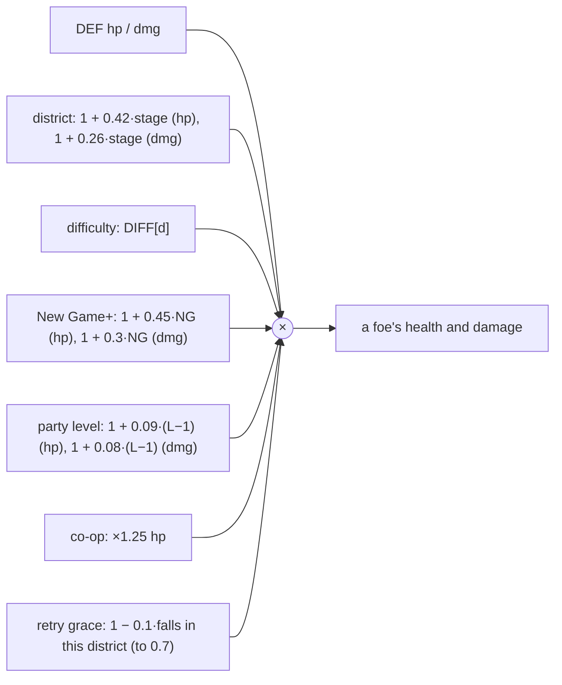

# Balancing

The numbers that decide how hard the game is, with where they live.

## Foes

The party-level factor (`lvlMul()`) keeps a regular foe at about four or five punches at any level. That also leaves time to daze and grab it. Jobs and training keep their own tuning.

Because foes grow with the runners, grinding levels barely moves a wall. So every *Run it again* in the same district eases its crews by 10%, down to 70% after three falls (`graceMul()` in `flow.js`, counted in `G.grace`). It applies only to the campaign: not the Gauntlet, the Arena or the Sprawl, and it resets on a new district or a new run.

## Volleys and beams

- A fan of shots is one attack: the projectiles share a `vol` list, and each runner can be hit by it once. This covers Voss's hex spread, ICE sentry lasers and a shaman's chain spell. Without it, a runner standing between two shots took both.
- Spreads of hexes (three, or five enraged) hit at 75% of the caster's damage each; a single hex hits in full.
- Black ICE's beam is telegraphed for most of a second and knocks down, so a hit is capped at 35% of the runner's maximum health.

## Damage to runners

Armor divides incoming damage: `dmg × 20 / (20 + armor)`. 20 armor halves every hit. Armor comes from the armor piece (× its rarity, × 1.3 per Plated part), dermal plating (+3 a level) and Body (half its value).

## Runner damage

| Source | Formula |
|---|---|
| Melee (`D.melee`) | `Strength × 1.6 + weapon damage + cyberarm × 3`, × 1.2 with Iron Fists, × 1.4 under Bare Knuckles, × 1.3 for adepts |
| A punch | `4 + melee × 0.65` (the uppercut `8 + melee × 0.9`, a kick `6 + melee × 0.8`) |
| A gun shot | `gun damage + Agility × 0.8`, × 1.2 with Steady Hands |
| Crit chance | `0.03 + 0.025 × Agility + 0.04 × wired + 0.08 × thermographic eyes` + weapon crit + Keen and Scoped parts |
| Crit damage | × 1.8 (× 2.5 with Deadeye on guns), × 1.25 more with a Scoped gun |

## Gear

| Tier | Name | Colour | Parts | Stat multiplier |
|---|---|---|---|---|
| 0 | Street | #efe9ff | 0 | ×1 |
| 1 | Tuned | #7dffb0 | 1 | ×1.12 |
| 2 | Prototype | #45d2ff | 2 | ×1.25 |
| 3 | Black-market | #b98cff | 3 | ×1.4 |
| 4 | Legendary | #ffa630 | 4 (or a named legendary) | ×1.55 |

Heavy parts add 20% damage each, and Plated parts 30% armor each. Prices are `base × (1 + 0.6 × tier)`, doubled for named legendaries.

## How it plays, measured

The campaign bot (tests/campaign-bot.test.js) plays the whole campaign on Runner difficulty. It plays the way a careful but simple player would: it walks up and fights, dodges shots already in the air, steps out of a lane an enemy is aiming down or that Black ICE has marked, and rolls behind mech walkers to hit the vent.

Before the November 2026 balance pass it needed anywhere from 5 to 31 continues, almost all at the Arcology's mech walker and Voss's rematch in the Host. Now it usually needs none or one, and occasionally three. **CI fails if it needs more than four** (`MAX_OVERS`), so a change that makes the late game much harder shows up on the pull request. It still plays far worse than a person.
