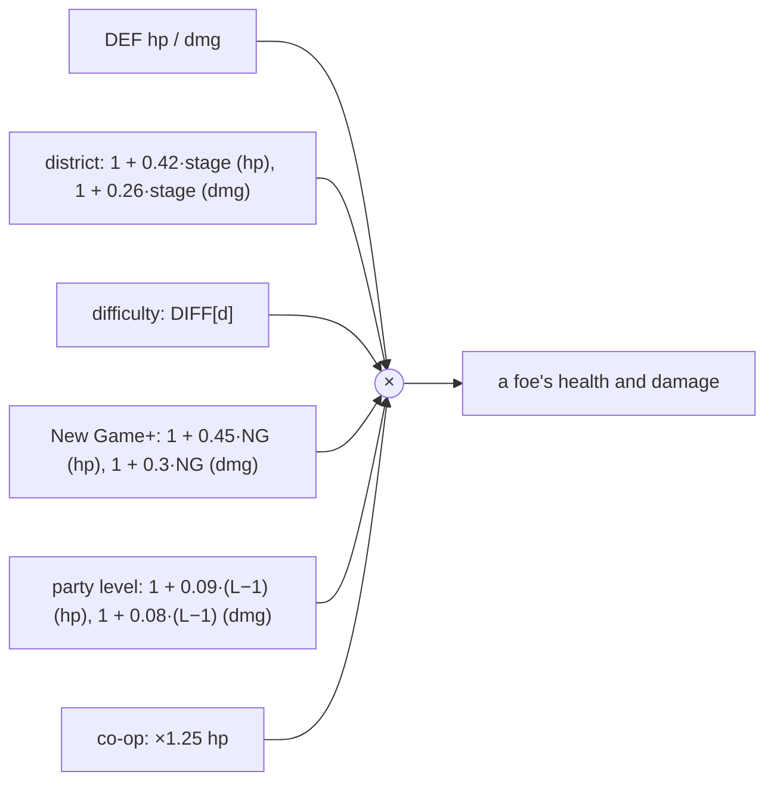

# Balancing

The numbers that decide how hard the game is, with where they live.

## Foes

The party-level factor (`lvlMul()`) keeps a regular foe at about four or five punches at any level. That also leaves time to daze and grab it. Jobs and training keep their own tuning.

## Damage to runners

Armor divides incoming damage: `dmg × 20 / (20 + armor)`. 20 armor halves every hit. Armor comes from the armor piece (× its rarity, × 1.3 per Plated part), dermal plating (+3 a level) and Body (half its value).

## Runner damage

| Source | Formula |
|---|---|
| Melee (`D.melee`) | `Strength × 1.6 + weapon damage + cyberarm × 3`, × 1.2 with Iron Fists, × 1.4 under Bare Knuckles, × 1.3 for adepts |
| A punch | `4 + melee × 0.65` (the uppercut `8 + melee × 0.9`, a kick `6 + melee × 0.8`) |
| A gun shot | `gun damage + Agility × 0.8`, × 1.2 with Steady Hands |
| Crit chance | `0.03 + 0.025 × Agility + 0.04 × wired + 0.08 × thermographic eyes` + weapon crit + Keen and Scoped parts |
| Crit damage | × 1.8 (× 2.5 with Deadeye on guns), × 1.25 more with a Scoped gun |

## Gear

| Tier | Name | Colour | Parts | Stat multiplier |
|---|---|---|---|---|
| 0 | Street | #efe9ff | 0 | ×1 |
| 1 | Tuned | #7dffb0 | 1 | ×1.12 |
| 2 | Prototype | #45d2ff | 2 | ×1.25 |
| 3 | Black-market | #b98cff | 3 | ×1.4 |
| 4 | Legendary | #ffa630 | 4 (or a named legendary) | ×1.55 |

Heavy parts add 20% damage each, and Plated parts 30% armor each. Prices are `base × (1 + 0.6 × tier)`, doubled for named legendaries.

## How it plays, measured

The campaign bot (tests/campaign-bot.test.js) plays the whole campaign on Runner difficulty. In November 2026, after level scaling and the gear rework, it wins every run, losing between 4 and 12 lives, mostly in the final district. It plays far worse than a person.
