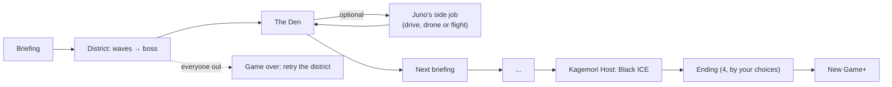

# Campaign

Six districts, each with waves of foes, a contract from Juno and a boss. Between them you walk the Den.

## Districts

| # | District | Tagline | Length | Waves | Boss wave | Weather |
|---|---|---|---|---|---|---|
| 1 | Rustline Barrens | Gang turf under the dead monorail | 1500 | 5 | Gutter King + Ganger | storm |
| 2 | Neon Market | Black clinics and street docs, three levels deep | 1700 | 5 | Razor Mei + Drone | rain |
| 3 | Undercity Tunnels | The old transit lines. Something down here is hungry. | 1700 | 5 | The Hollow Saint + Ghoul | fog |
| 4 | Undercity Market | A ghoul bazaar under the dead lines. Mother Vesper keeps the books. | 1650 | 5 | Mother Vesper + Thrall | clear |
| 5 | Kagemori Arcology | Top floor. The Director is waiting. | 1800 | 5 | Director Voss + Riot trooper | sleet |
| 6 | Kagemori Host | Jacked in. Voss uploaded herself into the corporate host. | 1800 | 5 | Black ICE + Glitch | rain |

## Contracts

| District | Contract | Goal | Creds | Karma |
|---|---|---|---|---|
| 1 | Clear the Barrens | Take down 8 gangers | ¥90 | 50 |
| 2 | Data run | Recover 3 data chips from corp security | ¥140 | 70 |
| 3 | Exorcism | Banish 4 fire spirits | ¥160 | 90 |
| 4 | Night market | Take down 6 thralls | ¥180 | 110 |
| 5 | Ghost | Reach Director Voss without losing a life | ¥100 | 140 |
| 6 | Trace | Crash 5 data nodes in the host | ¥0 | 180 |

## The Den

| NPC | Role | Id |
|---|---|---|
| Juno | fixer | juno |
| Sal | bartender | sal |
| Doc Kessler | street doc | doc |
| Old Wen | talismonger | wen |
| Ratchet | fence | ratchet |
| Kit | companion broker | kit |
| Pixel | street kid | pixel |

What they say changes after each job. Doc sells medkits, ammo, cyberware, chrome and a neural reset. Old Wen teaches spells. Ratchet fences gear, fits gun mods and runs the workbench. Kit rents companions.

## Juno's side jobs

In every Den, Juno offers one optional job, played with your campaign runners (their level, gear and skills). `cjobStart()` saves the Den and keeps a copy. When the job ends, `cjobBack()` reloads that copy, adds the take (creds and gear) and the karma the job earned, and marks the job done in `G.sideJobs`. It's one shot per Den, win or lose. Quit midway and the Den copy is untouched, so the job is still on offer.

| Den visit | Kind | Side job |
|---|---|---|
| After district 1 | drive | The Causeway Run |
| After district 2 | stealth | The Night Clinic |
| After district 3 | drive | Neon Market Getaway |
| After district 4 | stealth | Ghost in the Arcology |
| After district 5 | flight | Over the Skyline |

## Choices and endings

After the Undercity Market, Juno asks what to do with Vesper's books: sell them (¥250, but an extra Kagemori guard in every Arcology wave) or leak them (nothing, but one guard fewer). After the Arcology, Voss's backup core: wipe it (no Voss.exe in the host, more ICE) or keep it as a key (Black ICE starts a quarter weaker, Voss.exe waits). The four combinations give four epilogues.
