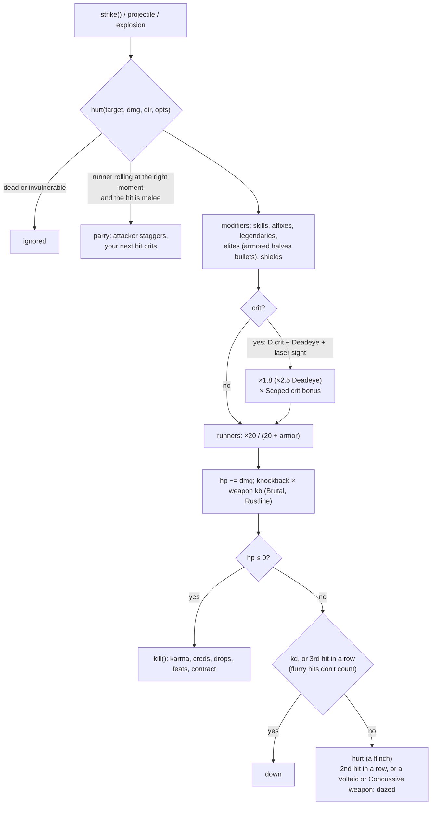
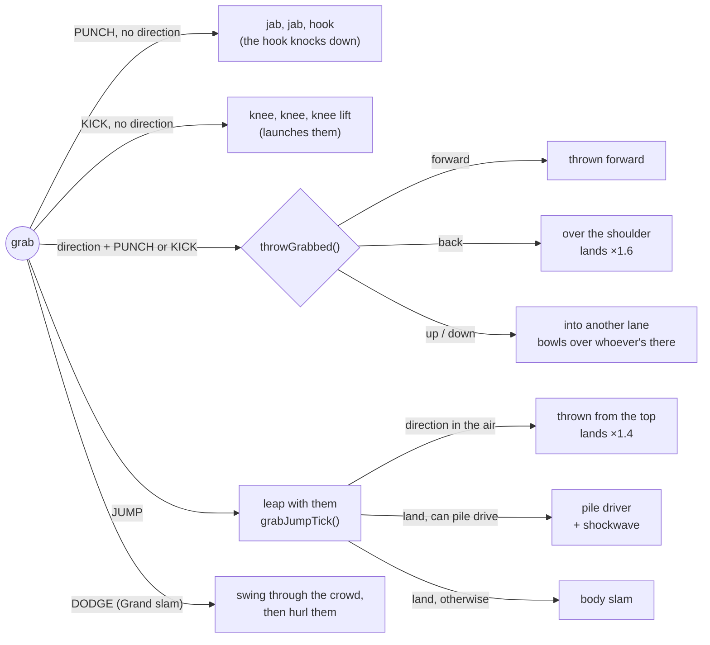

# Combat

Everything a runner does is a **state** on the runner (`p.state`, with `p.t` counting steps in it), advanced once per logic step by `upRunner()` in game/runners.js. Hits go through one function, `hurt()` in game/combat.js, whoever throws them.

## A runner's states

```mermaid
stateDiagram-v2
  [*] --> idle
  idle --> walk: a direction
  walk --> idle
  idle --> punch: PUNCH
  punch --> punch: again within the combo window
  punch --> upper: third quick punch
  punch --> mach: third quick punch (Mach fists)
  idle --> kick: KICK
  kick --> dragon: third quick kick (Dragon feet)
  idle --> heavy: hold PUNCH, release
  idle --> jump: JUMP
  jump --> jkick: PUNCH or KICK in the air
  idle --> roll: DODGE (a parry if a hit lands early in it)
  idle --> shoot: GUN
  idle --> cast: SPELL
  idle --> lift: PUNCH beside a prop
  lift --> throw: PUNCH again
  walk --> grab: walk into a dazed or reeling foe
  idle --> grab: PUNCH beside a downed foe (haul up)
  walk --> dashp: sprint + PUNCH (Turbo calves)
  walk --> slide: sprint + KICK
  idle --> stomp: KICK beside a downed foe (Heel spikes)
  grab --> idle: hook / knee lift / timeout
  grab --> throw: direction + PUNCH or KICK
  grab --> jthrow: JUMP
  grab --> pdrive: JUMP (samurai, adept or the rig)
  grab --> gslam: DODGE (Grand slam)
  jthrow --> idle: thrown in the air, or body slam on landing
  pdrive --> idle: thrown in the air, or pile driver on landing
  idle --> held: a foe grabs you
  held --> idle: mash to break free
  held --> down: kneed, then thrown
  idle --> hurt: hit
  hurt --> down: knockdown (or third hit in a row)
  down --> idle: get up (twice as fast with Recoil dampers)
  hurt --> dead: no HP left
  dead --> idle: respawn while lives remain
```

How long each move keeps you busy comes from `busyFor()`. Servo knuckles and Swift weapons shorten punches, Piston shins shorten kicks, and Quickdraw and Swift guns speed up shooting.

## The hit pipeline

## Dazes and the grab menu

A foe can be grabbed (`grabbable()`) unless it's a boss, a heavy (mech walkers), flying or passive. It's ready to grab (`dazed()`) when any of these is true:

| When | How long | Shown as |
|---|---|---|
| Flinching from any hit | about 14 steps | the flinch |
| Two hits in a row | 60 steps (110 with Grip actuators) | stars over the head |
| One hit from a Voltaic or Concussive weapon | the same | stars |
| Under 30% health (`reeling()`) | until healed or dead | stars |
| Knocked down: punch beside it (`haulUp()`) | — | "UP YOU GET" |

The direction you walked in with is locked (`grabLockX/Y`), so it only counts as a throw once you let go of it or change it. A grab lasts 100 steps (180 with Grip actuators). Street samurai and physical adepts can pile drive; anyone else needs the Pile driver rig (`canPile()`).

## Foes fight back the same way

`streetChoose()` lets some foes pick a River City move instead of a plain swing, and `streetTick()` runs it:

| Move | Who (`DEF` flag) | Tell | Counter |
|---|---|---|---|
| Grab | `grab`: gangers, orcs, the Gutter King | "!" | Roll out of reach, or once held mash any button (`holdNeed`: 4, 6, or 10 for bosses). A partner's hit frees you |
| Flurry | `flurry`: Razor Mei (punches), Kagemori shadows (kicks) | a ring and "!!" | Roll through it, or parry it |
| Throw a prop | `thrower`: gangers, orcs | walks to a can, crate or drum | Get out of the lane, or punch them while they carry it (they drop it) |

## Chrome techniques and moves

Doc sells them in the Den, and clinics sell them in the Sprawl. Each costs 4 max mana and is saved per runner in `p.tech`, checked with `hasTech(p, key)`.

| Chrome | Kind | Price | Effect | Known already by |
|---|---|---|---|---|
| Servo knuckles | Technique | ¥260 | Punches and uppercuts recover a third faster, and the combo window stays open longer. |  |
| Piston shins | Technique | ¥280 | Kicks recover a third faster and knock foes further back. |  |
| Grip actuators | Technique | ¥300 | Foes you daze stay dazed almost twice as long, you hold a grab longer, and grab punches and knees hit 40% harder. |  |
| Gyro spine | Technique | ¥340 | Throws fly further and hit twice as hard, both on landing and on anyone in the way; body slams, pile drivers and Grand slam hit 50% harder. |  |
| Spring tendons | Technique | ¥300 | Jump higher, and one flying kick can hit twice. |  |
| Recoil dampers | Technique | ¥240 | Back on your feet twice as fast after a knockdown. |  |
| Mach fists | Move | ¥420 | Your third quick punch becomes a flurry of jabs. Keep mashing PUNCH to keep it going; it ends in an uppercut. |  |
| Dragon feet | Move | ¥440 | Your third quick kick becomes a flurry of kicks. Keep mashing KICK to keep it going; it ends with a big kick. |  |
| Grand slam | Move | ¥480 | While holding a grabbed foe, press DODGE to swing them round through everyone close, then hurl them. |  |
| Pile driver rig | Move | ¥460 | Leap with a grabbed foe (JUMP) and land without pushing a direction: a pile driver, head-first into the street, with a shockwave. Street samurai and adepts already know it. | street samurai, adepts |
| Heel spikes | Move | ¥360 | KICK next to a foe on the ground to stomp them. |  |
| Turbo calves | Move | ¥400 | Tap a direction twice to sprint. PUNCH out of a sprint for a shoulder charge, KICK for a slide. |  |

## Specials, parries and props

- **Special (★):** the meter fills as you fight. Punch and kick together (or the special button) unleash the archetype's special.
- **Parry:** dodge within about 0.13 s of a melee hit landing. You take nothing, the attacker staggers, and your next hit within 1.5 s crits.
- **Props:** cans, crates and explosive drums. Lift with punch, throw with punch, drop with kick. A drum explodes on whichever side didn't throw it.
