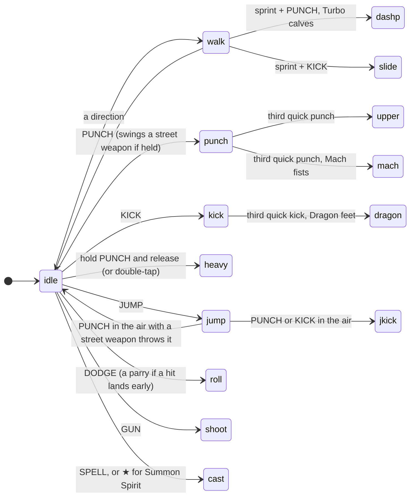
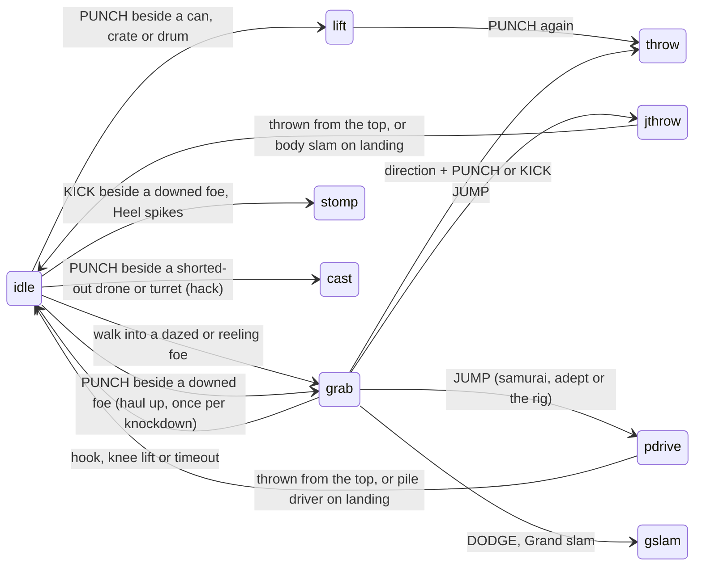
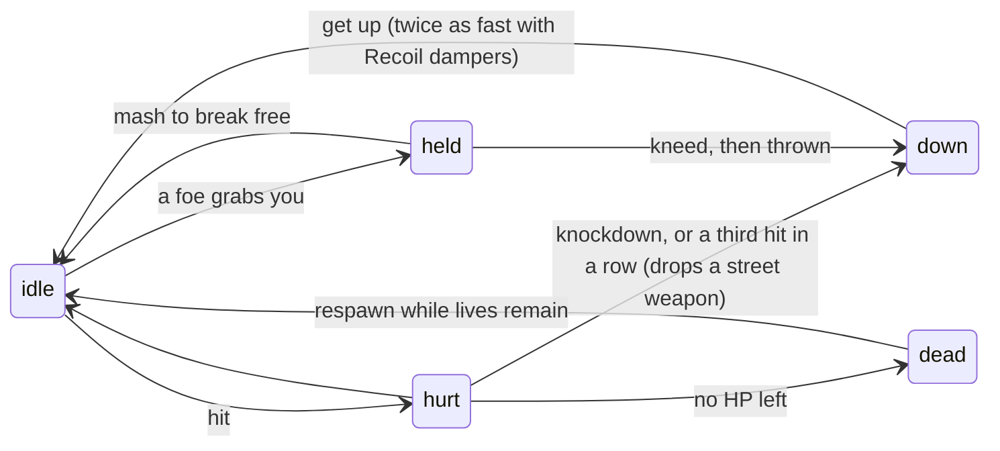
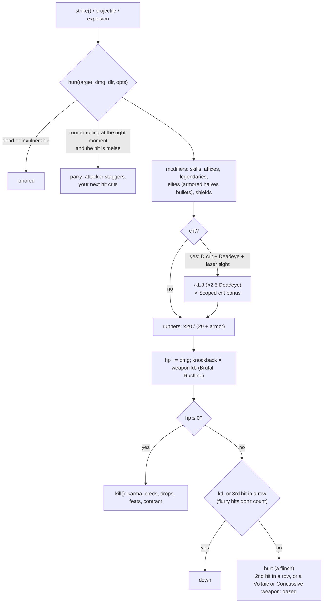
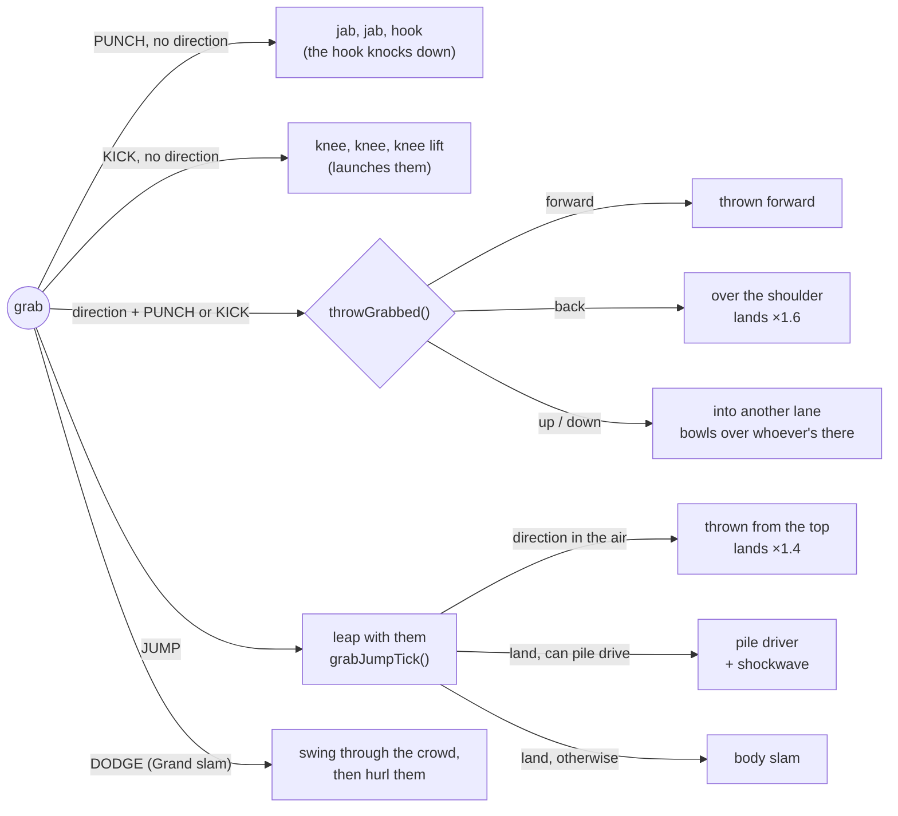
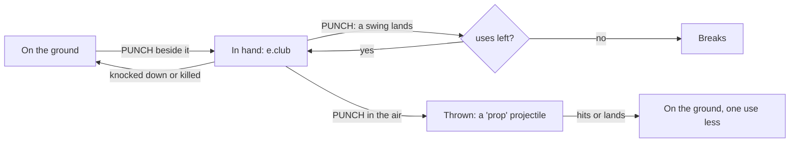
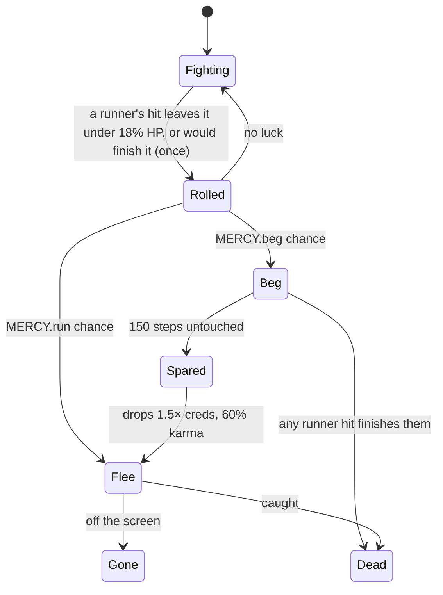

# Combat

Everything a runner does is a **state** on the runner (`p.state`, with `p.t` counting steps in it), advanced once per logic step by `upRunner()` in game/runners.js. Hits go through one function, `hurt()` in game/combat.js, whoever throws them.

## A runner's states

One diagram per family of moves, so each stays readable. Every busy state returns to `idle` when it ends.

### Strikes and movement

### Grabs, props and hacks

### Getting hit

How long each move keeps you busy comes from `busyFor()`. Servo knuckles and Swift weapons shorten punches, Piston shins shorten kicks, and Quickdraw and Swift guns speed up shooting.

## The hit pipeline

## Dazes and the grab menu

A foe can be grabbed (`grabbable()`) unless it's a boss, a heavy (mech walkers), flying or passive. It's ready to grab (`dazed()`) when any of these is true:

| When | How long | Shown as |
|---|---|---|
| Flinching from any hit | about 14 steps | the flinch |
| Two hits in a row | 60 steps (110 with Grip actuators) | stars over the head |
| One hit from a Voltaic or Concussive weapon | the same | stars |
| Under 30% health (`reeling()`) | until healed or dead | stars |
| Knocked down: punch beside it (`haulUp()`) | — | "UP YOU GET" |

The direction you walked in with is locked (`grabLockX/Y`), so it only counts as a throw once you let go of it or change it. A grab lasts 100 steps (180 with Grip actuators). Street samurai and physical adepts can pile drive; anyone else needs the Pile driver rig (`canPile()`).

## Foes fight back the same way

`streetChoose()` lets some foes pick a River City move instead of a plain swing, and `streetTick()` runs it:

| Move | Who (`DEF` flag) | Tell | Counter |
|---|---|---|---|
| Grab | `grab`: gangers, orcs, the Gutter King | "!" | Roll out of reach, or once held mash any button (`holdNeed`: 4, 6, or 10 for bosses). A partner's hit frees you |
| Flurry | `flurry`: Razor Mei (punches), Kagemori shadows (kicks) | a ring and "!!" | Roll through it, or parry it |
| Throw a prop | `thrower`: gangers, orcs | walks to a can, crate or drum | Get out of the lane, or punch them while they carry it (they drop it) |

## Chrome techniques and moves

Doc sells them in the Den, and clinics sell them in the Sprawl. Each costs 4 max mana and is saved per runner in `p.tech`, checked with `hasTech(p, key)`.

| Chrome | Kind | Price | Effect | Known already by |
|---|---|---|---|---|
| Servo knuckles | Technique | ¥260 | Punches and uppercuts recover a third faster, and the combo window stays open longer. |  |
| Piston shins | Technique | ¥280 | Kicks recover a third faster and knock foes further back. |  |
| Grip actuators | Technique | ¥300 | Foes you daze stay dazed almost twice as long, you hold a grab longer, and grab punches and knees hit 40% harder. |  |
| Gyro spine | Technique | ¥340 | Throws fly further and hit twice as hard, both on landing and on anyone in the way; body slams, pile drivers and Grand slam hit 50% harder. |  |
| Spring tendons | Technique | ¥300 | Jump higher, and one flying kick can hit twice. |  |
| Recoil dampers | Technique | ¥240 | Back on your feet twice as fast after a knockdown. |  |
| Mach fists | Move | ¥420 | Your third quick punch becomes a flurry of jabs. Keep mashing PUNCH to keep it going; it ends in an uppercut. |  |
| Dragon feet | Move | ¥440 | Your third quick kick becomes a flurry of kicks. Keep mashing KICK to keep it going; it ends with a big kick. |  |
| Grand slam | Move | ¥480 | While holding a grabbed foe, press DODGE to swing them round through everyone close, then hurl them. |  |
| Pile driver rig | Move | ¥460 | Leap with a grabbed foe (JUMP) and land without pushing a direction: a pile driver, head-first into the street, with a shockwave. Street samurai and adepts already know it. | street samurai, adepts |
| Heel spikes | Move | ¥360 | KICK next to a foe on the ground to stomp them. |  |
| Turbo calves | Move | ¥400 | Tap a direction twice to sprint. PUNCH out of a sprint for a shoulder charge, KICK for a slide. |  |

## Specials, parries and props

- **Special (★):** the meter fills as you fight. Punch and kick together (or the special button) unleash the archetype's special.
- **Parry:** dodge within about 0.13 s of a melee hit landing. You take nothing, the attacker staggers, and your next hit within 1.5 s crits.
- **Props:** cans, crates and explosive drums. Lift with punch, throw with punch, drop with kick. A drum explodes on whichever side didn't throw it.

## River City street fights

### Street weapons

Pipes, chains and bats are props with a `uses` count (`CLUBS` in data/content.js; logic in game/props.js). Two lie along every district (`startStage`), most Arena waves add one, and `CLUB_FOES` gives gangers, bikers and orcs a chance to walk in carrying one.

| Weapon | Swing damage | Extra reach | Swings that land | Knockback | Foe damage × | Finisher |
|---|---|---|---|---|---|---|
| Lead pipe | +7 | +6 | 8 | 6 | 1.3 | uppercut |
| Bike chain | +5 | +16 | 10 | 4 | 1.2 | uppercut |
| Spiked bat | +10 | +9 | 5 | 8 | 1.45 | knocks down |

- A runner's punch picks a weapon up even mid-fight, as long as they aren't already holding one. Swings are 15% slower, and Mach fists and Swift weapons don't apply while you hold one.
- Foes with a weapon add its reach and multiply their damage; the bat's swing knocks down. Gangers walk over to pick one up off the street, and throw it from 50–200 px in the same lane.

### Wall bounces and juggles

`wallBounce(e)` in game/runners.js runs in `physics()` for a foe knocked down and still in the air.

| Condition | Value |
|---|---|
| Walls | the screen's edges while `G.lock` holds the camera (always in the Arena, buildings and training); otherwise the street's own ends |
| Needs | in the air (z ≥ 6), moving at least 1.5 px a step, not a boss, once per knockdown |
| Bounce | reverses at 75% speed, pops up (vz ≥ 3), takes 3 + 5% of max HP |
| Juggle | `canJuggle`: a runner's hits land on a bounced foe still in the air, up to three, each one relaunching it |

### Mercy, runners and taunts

| Foe | Begs | Runs |
|---|---|---|
| Ganger | 35% | – |
| Orc | 20% | – |
| Cop | 25% | – |
| Biker | – | 35% |
| Corp security | – | 30% |
| Thrall | – | 20% |

Only a runner's hit can make a foe quit, and the blow that would finish one can be the moment it gives up (on 1 HP, unless the hit is over 60% of its max HP). Bosses, elites, hit squads, bounty hunters and couriers never quit, nor do an open contract's targets (so the contract can always be finished), and nobody begs in Training or under Pacifist. A spared foe leaves untouchable. Sparing counts toward the Street Mercy feat (10), and wall bounces toward Off the Wall (25). Sparing a cop or guard in the Sprawl lifts your street cred by one. Bosses say a line from `TAUNTS` when they enrage (half health) and again under a quarter.

## Environmental finishers

game/finishers.js. While a thrown foe is in the air, `upEnemy()` calls `envTick()`, which checks three things: a burning barrel within 14 px when the foe is in the back lane (`barrelAt()`, from `fixtureAt()`, the same function the renderer draws the street's barrels and lamps from), a drum in `G.props` (it's removed and `shatter()`ed with the thrower as its source), and the live lane of a `shock` hazard while it's live. `envFinish()` drops creds (20 + 12 × depth) and a 25% shot at gear, then takes the foe's remaining health, or a quarter of a boss's. Each one bumps `envkills`, toward the *Use the Scenery* feat.
