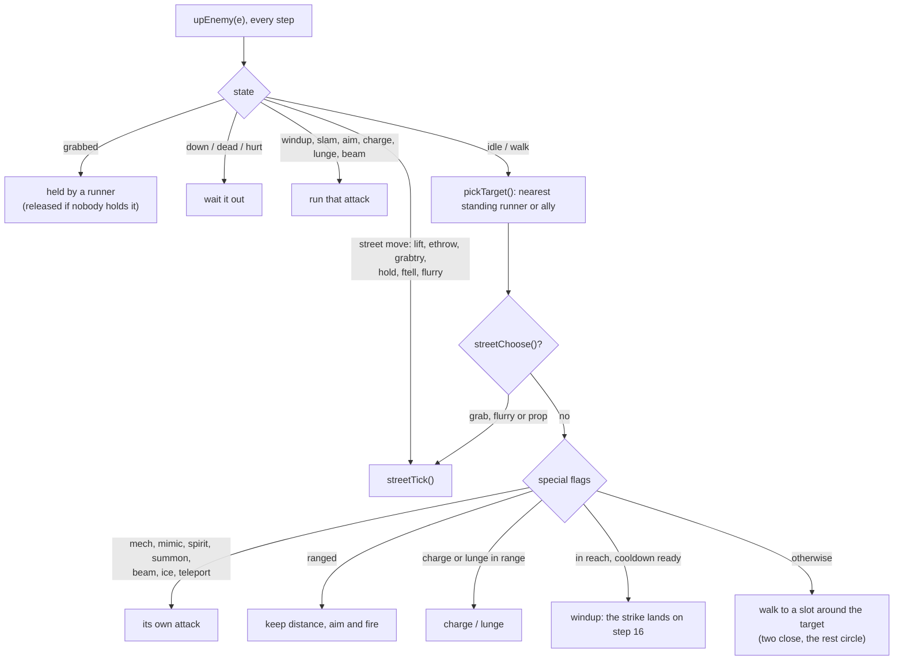
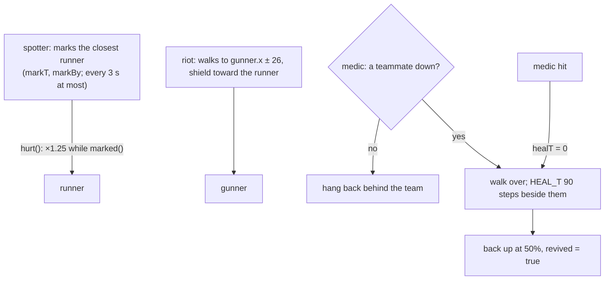
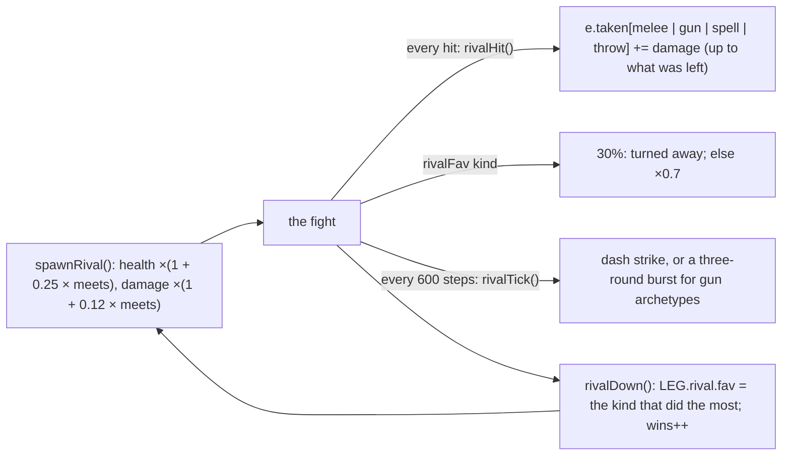

# Enemies

Every foe is a `DEF` entry in data/content.js. Its flags switch on behaviours in game/enemies.js, and `spawnEnemy()` (game/flow.js) scales it to where and how strong you are.

## How a foe decides

## Every foe

Base numbers before scaling (see below). Bosses enrage at half health.

| Key | Name | HP | Dmg | Reach | Speed | Cooldown | Behaviours | Bestiary note |
|---|---|---|---|---|---|---|---|---|
| `biker` | Road ganger | 30 | 7 | 26 | 1 | 64 |  | Causeway crews on stripped-down bikes and a length of chain. Pull alongside and they swing; kick them into the rail before they do. |
| `interceptor` | Kagemori Interceptor | 300 | 14 | 30 | 1 | 90 | boss | An armored Kagemori van that hunts the causeway at the end of every run. It rams from the side. Bullets and boots crack the plating; fists j |
| `ganger` | Ganger | 28 | 6 | 22 | 0.85 | 72 | grab, thrower | Rustline crews. Cheap chrome, cheap knives, a lot of nerve. They grab (a "!" warns you; mash to break free) and pick up cans, crates and dru |
| `orc` | Orc bruiser | 56 | 10 | 24 | 0.7 | 86 | grab, thrower | Big, tough and not as slow as they look. They grab and hold on longer than gangers (mash to break free), and throw whatever is lying around. |
| `sec` | Corp security | 34 | 9 | 22 | 0.8 | 115 | ranged:bullet | Kagemori security on a corp salary. They shoot first and file reports later. |
| `riot` | Riot trooper | 58 | 12 | 24 | 0.6 | 95 |  | Shields stop punches from the front. Kick them, throw something, or get behind. In a fireteam, they stand in front of the gunner. |
| `rival` | Vane | 120 | 11 | 24 | 1.05 | 70 | rival | Your rival: fights in your archetype's style and remembers the attack you won with. |
| `spotter` | Kagemori spotter | 28 | 6 | 20 | 0.75 | 130 | ranged:bullet, role:spot | Fireteam eyes: marks a runner, who takes 25% more until the spotter goes down. |
| `medic` | Kagemori medic | 36 | 7 | 20 | 0.9 | 120 | role:medic | Fireteam medics get a downed teammate back up, once each. |
| `shaman` | Street shaman | 30 | 11 | 20 | 0.75 | 150 | ranged:hex | Street shamans throw spells from the back line. Close the distance fast. |
| `ghoul` | Ghoul | 22 | 7 | 18 | 1.25 | 55 | lunge | They lunge from far away. Roll through and punish the recovery. |
| `thrall` | Thrall | 40 | 8 | 22 | 1.15 | 66 | drain | Mother Vesper's people. Quick, pale, and every hit they land heals them a little. Don't trade blows; stagger them and keep the pressure on. |
| `spirit` | Fire spirit | 40 | 8 |  | 0.75 | 70 | fly, spirit | Bound fire spirits. Bullets pass right through them; use fists, blades or magic. |
| `ninja` | Kagemori shadow | 30 | 12 | 24 | 1.1 | 80 | flurry:dragon, stealth | Kagemori shadows fade out of sight and only show themselves to strike. Hit one and the cloak drops for a few seconds. Watch for the ring and |
| `mech` | Kagemori mech walker | 150 | 11 | 30 | 0.38 | 110 | ranged:bullet, heavy, mech | A walking gun platform. Its front plates shrug off almost everything, and it turns slowly. Get behind it and hit the glowing vent on its bac |
| `feral` | Feral spirit | 34 | 10 |  | 0.7 | 130 | fly, mimic, spirit | A wild spirit that watches you fight and throws your last spell back at you. Think twice before you cast near one. |
| `hound` | Hellhound | 18 | 6 | 18 | 1.45 | 50 | lunge, pack | Hellhounds hunt in packs, and every hound still standing makes the pack faster. Thin them out early. |
| `cop` | Patrol officer | 38 | 9 | 22 | 0.85 | 105 | ranged:bullet | Lone Star patrol, contracted to Kagemori. Every one you drop raises the heat. |
| `glitch` | Glitch | 30 | 8 | 20 | 1.2 | 60 |  | Corrupted code with a body. Kill one and it splits in two. |
| `ice` | ICE sentry | 30 | 9 |  | 0.9 | 110 | ranged:laser, fly | ICE sentries teleport and fire laser spreads. Watch the windup. |
| `blackice` | Black ICE | 330 | 16 |  | 0.7 | 120 | boss, fly, beam | Black ICE fires lane-wide beams. Change lanes or roll, then hit the core while it vents. |
| `drone` | Drone | 18 | 7 |  | 1.1 | 125 | ranged:bullet, fly | Rigger drones keep their distance and shoot. Jump-kick them out of the air. Short one out and PUNCH beside it to hack it. |
| `turret` | Sentry turret | 60 | 8 |  | 0 | 95 | turret, heavy | Sentry turrets hold the back wall of black sites and precincts. Get out of their lane, or short one out and hack it. |
| `troll` | Gutter King | 220 | 15 | 30 | 0.75 | 80 | boss, charge, grab | The Gutter King. Huge hits and ground slams once he's angry. Jump the shockwaves, and don't stand still in front of him: he grabs, and it ta |
| `blade` | Razor Mei | 200 | 13 | 26 | 1.15 | 55 | boss, charge, flurry:mach | Razor Mei dashes through you, then chains three dashes when she's enraged. A ring and "!!" mean a punch flurry: roll through it or parry it. |
| `saint` | The Hollow Saint | 240 | 13 | 24 | 1 | 70 | boss, lunge, summon | The Hollow Saint summons spirits and slams the floor. Keep moving. |
| `avatar` | Avatar of Ssareth | 560 | 17 | 28 | 1.05 | 62 | boss, lunge, summon | Ssareth's avatar: a vessel of chrome and bound fire. It summons spirits, lunges and slams. The great dragon is watching through its eyes. |
| `dragon` | Ssareth | 1500 | 20 | 62 | 0.55 | 80 | boss, heavy | Ssareth, who lights the way. On the ground it claws and sweeps its tail; in the air you can only shoot it, cast at it or jump-kick it, while |
| `vesper` | Mother Vesper | 280 | 14 | 26 | 1.05 | 60 | boss, drain | Mother Vesper steps into mist and reforms behind you mid-swing. Roll as the fog closes in, and remember she drinks from every hit. Once angr |
| `archmage` | Director Voss | 270 | 13 | 24 | 0.8 | 100 | boss, ranged:hex3, teleport | Director Voss teleports and fires hexes, five at a time when enraged. |

## Fireteams

A **fireteam** is four foes with one `e.unit` id: `spotter`, `riot`, `sec` and `medic` (`TEAM_KINDS`). A wave's `'team'` entry expands to one (`teamSpawnList()`, used by `waves()`; the Arcology's first wave has one), and `spawnTeam()` puts one in half the inner rooms of black sites. `unitTick()` runs each role before the usual AI:

A hit on the spotter clears its mark (`hurt()`), and a spotter waits 360 steps between marks. A downed unit member waits up to 420 steps (instead of 70) while their medic is up. `kill()` on a foe with `revived` set pays nothing (no drops, karma, kill count or contract tick) and marks it `'twice'`, so a medic can't be farmed. In `choiceSpawn()`, a `'team'` counts as four for the leaked-books guard removal.

## Vane, the rival

game/rival.js. `rivalWave()` (from `waves()`) spawns Vane with the wave before the boss in districts `RIVAL_STAGES` (1, 3, 4), once per run each (`G.run.rival`), never in the Gauntlet, the Arena, the Sprawl or a side job; `rivalStreet()` brings Vane to Sprawl blocks `RIVAL_BLOCKS` (2, 4) once each (`w.rivalDone`) when the street is quiet.

`LEG.rival = { meets, wins, fav }` lives in the legend, so it carries from run to run; `rivalRec()` resets a malformed one. Throws count too: the landing damage in `physics()` goes through `rivalHit()` with `{ thrownBy }`.

## Elites

Any regular foe can spawn as an elite, more often on harder difficulty and New Game+. Elites always drop gear.

| Elite | Aura colour | Effect |
|---|---|---|
| Armored | #9fb4d8 | +70% HP, shrugs off bullets |
| Berserk | #ff4a4a | faster and hits harder |
| Warded | #45d2ff | can't be knocked down, resists magic |
| Vampiric | #b98cff | heals when it hits you |

## Scaling

A foe's health and damage are its `DEF` numbers multiplied together:

| Factor | Health | Damage | Where |
|---|---|---|---|
| District (`G.stage`, 0–5) | 1 + 0.42 × stage | 1 + 0.26 × stage | `spawnEnemy()` |
| Difficulty | `DIFF[d].hp` | `DIFF[d].dmg` | data/world.js |
| New Game+ | 1 + 0.45 × NG | 1 + 0.3 × NG | `ngMul()` |
| Party level (average) | 1 + 0.09 × (level − 1) | 1 + 0.08 × (level − 1) | `lvlMul()` (off in jobs and training) |
| Co-op | × 1.25 | — | |
| Elite | Armored × 1.7, Warded × 1.25 | Berserk × 1.3 | |

| Difficulty | Foe HP × | Foe dmg × | Cooldown × | Elite chance | Karma × | Description |
|---|---|---|---|---|---|---|
| Street | 0.75 | 0.7 | 1.25 | 0.03 | 0.9 | Softer hits, fewer elites. For learning the streets. |
| Runner | 1 | 1 | 1 | 0.08 | 1 | The intended run. Elites show up from the start. |
| Prime | 1.35 | 1.35 | 0.8 | 0.16 | 1.3 | Faster, tougher, meaner. Elites everywhere, and they hit hard. |
