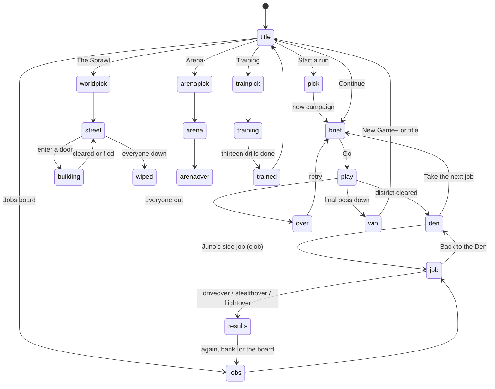

# Game modes

Everything starts at the title screen (or the online hub, `nethub`, when you're hosting). Each mode sets its own flags on `G` and clears the others through `resetWorld()`, so a mode never inherits another's state.

| Mode | Flag on `G` | Entry | Step | Ends |
|---|---|---|---|---|
| Campaign district | (none) and `G.stage` | `startStage(i)` | `waves()` | `stageClear()` → the Den, or `over` |
| The Den | `G.den` | `enterDen()` | `denTick()` | walk off the right, or Juno's next-job button |
| The Sprawl street | `G.world` | `enterStreet()` | `worldTick()` | a door, or a wipe |
| Sprawl building | `G.world` and `G.dun` | `openDoor()` → `enterBuilding()` | `dunTick()`, room by room (`enterRoom()`) | `exitBuilding()`, or a wipe (`worldWipe()`) |
| Arena | `G.arena` | `startArena()` | `arenaTick()` | `arenaOver()` |
| Training | `G.training` | `startTraining()` | `trainTick()` | thirteen drills, or skip |
| Driving job | `G.drive` | `startDrive()` | `driveUpdate()` | `driveFinish()` → `driveover` |
| Drone job | `G.stealth` | `startStealth()` | `stealthUpdate()` | `stealthFinish()` → `stealthover` |
| Flight job | `G.flight` | `startFlight()` | `flightUpdate()`, then `roofTick()` on a roof | `flightFinish()` → `flightover` |
| Juno's side job | `G.cjob` alongside the job's flag | `cjobStart()` | the job's own step | `cjobBack()` → the Den |
| Online | `NET` | host or join | snapshots | `netLost()` → rejoin |

## Difficulty, New Game+ and mutators

Difficulty (Street, Runner or Prime) is chosen with the archetype. New Game+ repeats the campaign with your runners and raises foes further. Mutators are optional rules for a run, each worth 20% more karma. The numbers are on [[Enemies]] and [[Balancing]].

| Difficulty | Foe HP × | Foe dmg × | Cooldown × | Elite chance | Karma × | Description |
|---|---|---|---|---|---|---|
| Street | 0.75 | 0.7 | 1.25 | 0.03 | 0.9 | Softer hits, fewer elites. For learning the streets. |
| Runner | 1 | 1 | 1 | 0.08 | 1 | The intended run. Elites show up from the start. |
| Prime | 1.35 | 1.35 | 0.8 | 0.16 | 1.3 | Faster, tougher, meaner. Elites everywhere, and they hit hard. |

| Mutator | Rule |
|---|---|
| Glass Cannon | Everyone hits 60% harder, you included. |
| Elite Streets | Every regular enemy is an elite. |
| Bare Knuckles | Guns are locked; punches and kicks hit 40% harder. |
| One Life | Each runner gets one life per district. |
| Turbo | Everything runs 25% faster, you included. |
| Fog | Enemies stay hidden until they are close. |
| Split | Regular enemies split in two when they go down. |
| Pacifist | Clear a district without firing a gun for double contract karma. |
