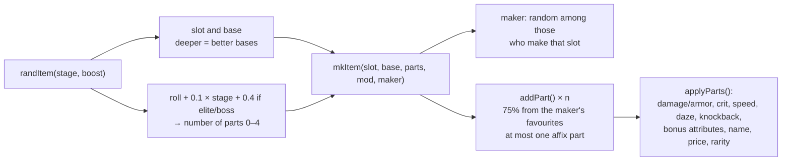

# Gear and loot

Gear works like Borderlands. A runner has three slots: melee weapon, gun and armor. Every piece has a **base** (what it is), a **maker** (its speciality) and **0–4 parts**. The number of parts is the rarity, and the rarity is the colour.

## Rarity

| Tier | Name | Colour | Parts | Stat multiplier |
|---|---|---|---|---|
| 0 | Street | #efe9ff | 0 | ×1 |
| 1 | Tuned | #7dffb0 | 1 | ×1.12 |
| 2 | Prototype | #45d2ff | 2 | ×1.25 |
| 3 | Black-market | #b98cff | 3 | ×1.4 |
| 4 | Legendary | #ffa630 | 4 (or a named legendary) | ×1.55 |

Each tier also adds a point to the maker's attribute. Named legendaries (unlocked by feats) are always the orange tier, with two parts and their unique effect.

## Makers

| Key | Maker | Colour | Speciality | Attribute | Makes | Favoured parts |
|---|---|---|---|---|---|---|
| `kagemori` | Kagemori | #ff3d4a | Precision: crits | agi | weapon, gun, armor | keen, sight, swift, attr, plated |
| `rustline` | Rustline Forge | #ff8a3d | Raw damage and knockback | str | weapon, gun, armor | heavy, brutal, burn, attr, plated, spiked |
| `voltaic` | Voltaic | #45d2ff | Shock and fire; its melee weapons always daze | hak | weapon, gun | shock, burn, swift, concuss, drum |
| `hexwright` | Hexwright | #b98cff | Magic: mana, spell power, leeching | mag | weapon, gun, armor | attr, leech, warded, keen, padded |
| `ironside` | Ironside Arms | #c9d1e0 | Speed: faster swings and fire, bigger mags | bod | weapon, gun, armor | swift, drum, heavy, padded, plated |

## Parts

| Key | Part | Slots | Effect |
|---|---|---|---|
| `heavy` | Heavy | weapon, gun | +20% damage |
| `brutal` | Brutal | weapon | knocks foes further |
| `keen` | Keen | weapon, gun | +8% crit chance |
| `sight` | Scoped | gun | +6% crit chance and crits hit harder |
| `swift` | Swift | weapon, gun, armor | attacks recover 20% faster |
| `concuss` | Concussive | weapon | one hit dazes a foe (ready to grab) |
| `drum` | Drum-fed | gun | ammo pickups give 50% more rounds |
| `attr` | Augmented | weapon, gun, armor | +2 more to the maker’s attribute |
| `shock` | Shock | weapon, gun | 25% chance to stun, delaying the target's next attack |
| `burn` | Incendiary | weapon, gun | Sets targets on fire for extra damage over 2 seconds |
| `leech` | Leeching | weapon, gun | Heals you for 15% of the damage you deal |
| `plated` | Plated | armor | +30% armor |
| `spiked` | Spiked | armor | Enemies that hit you in melee take 6 damage |
| `padded` | Padded | armor | +25 max HP |
| `warded` | Warded | armor | +2 Magic |

The affix parts carry these effects (older saves can still have them as a plain affix):

| Key | Affix | Slots | Effect |
|---|---|---|---|
| shock | Shock | weapon, gun | 25% chance to stun, delaying the target's next attack |
| burn | Incendiary | weapon, gun | Sets targets on fire for extra damage over 2 seconds |
| leech | Leeching | weapon, gun | Heals you for 15% of the damage you deal |
| keen | Keen | weapon, gun | +8% crit chance |
| spiked | Spiked | armor | Enemies that hit you in melee take 6 damage |
| padded | Padded | armor | +25 max HP |

## Bases

### Melee weapons

| Key | Weapon | Damage | Reach | Price | Look | Heavy blow / notes |
|---|---|---|---|---|---|---|
| `pipe` | Lead pipe | 3 | 2 | ¥40 | pipe |  |
| `knucks` | Spur knuckles | 4 | 0 | ¥70 | knucks | +8% crit, heavy blow is a three-hit flurry |
| `baton` | Shock baton | 5 | 4 | ¥90 | baton | heavy blow stuns everything it hits |
| `katana` | Katana | 8 | 8 | ¥180 | blade | heavy blow is a dash slash |
| `axe` | Fire axe | 10 | 6 | ¥240 | axe | every hit breaks guards, heavy blow cleaves both ways |
| `whip` | Monowhip | 11 | 14 | ¥320 | whip | heavy blow yanks a distant enemy to you |
| `hammer` | Gravity hammer | 15 | 7 | ¥420 | hammer | breaks guards, heavy blow is a ground pound |

### Guns

| Key | Gun | Damage | Fire | Price |
|---|---|---|---|---|
| `light` | Streetline pistol | 11 | single shot | ¥50 |
| `heavy` | Heavy pistol | 17 | single shot | ¥120 |
| `smg` | Machine pistol | 8 | 3-round burst | ¥170 |
| `shot` | Sawed-off shotgun | 22 | close-range spread | ¥220 |
| `rifle` | Assault rifle | 9 | 4-round auto | ¥260 |
| `smart` | Smartgun | 15 | smart rounds that track targets | ¥300 |
| `rail` | Railgun | 30 | rail slug that pierces every target | ¥380 |
| `launcher` | Grenade launcher | 26 | arcing grenade that explodes | ¥420 |

### Armor

| Key | Armor | Armor value | Price | Bonus |
|---|---|---|---|---|
| `coat` | Lined coat | 3 | ¥40 |  |
| `robe` | Warded duster | 2 | ¥100 | +2 mag |
| `jacket` | Armor jacket | 6 | ¥110 |  |
| `weave` | Form-fit weave | 4 | ¥130 | +1 agi |
| `cloak` | Thermoptic cloak | 5 | ¥260 | +2 agi, +1 hak |
| `vest` | Riot vest | 9 | ¥200 |  |
| `exo` | Exo-frame | 13 | ¥340 | +2 str, -1 agi |

## Legendaries

| Legendary | Slot | Base | Effect | Unlocked by feat |
|---|---|---|---|---|
| Ronin's Last Edge | weapon | Katana | Every sixth melee hit is a guaranteed crit. | Folk Hero |
| Vesper's Fang | weapon | Katana | Every takedown restores 8 HP and 5 mana. | Closing Time |
| Saint's Cinder Maul | weapon | Gravity hammer | Heavy blows erupt in a fire blast. | Ash to Ash |
| Mei's Silk | weapon | Monowhip | Melee hits have a 30% chance to lash a second enemy. | Cut the Razor |
| King's Boomstick | gun | Sawed-off shotgun | Fires five pellets that knock enemies down. | Dethroned |
| Voss's Smartlink | gun | Smartgun | Half your hits arc lightning to another enemy. | Hostile Takeover |
| Wyrmfang | gun | Railgun | Rail slugs set every target on fire, and half your shots cost no ammo. | Most Wanted |
| Black ICE Shard | armor | Thermoptic cloak | Deflects one hit every eight seconds. | Defragmented |
| Dragonscale Duster | armor | Warded duster | Damage you take restores half as much mana. | Off the Map |
| The Lantern | gun | Grenade launcher | Every takedown heals 5% HP and restores 5 mana for the whole team. | Lights Out |
| Wyrmheart | armor | Exo-frame | +40 max HP, fire hurts you half as much, and your special meter fills 25% faster. | Who Lights the Way |

## Gun mods

Ratchet fits one mod per gun, and it stays with the gun.

| Key | Gun mod | Price | Effect |
|---|---|---|---|
| mag | Extended mag | ¥150 | Ammo pickups give 50% more rounds. |
| laser | Laser sight | ¥200 | +10% crit chance with this gun. |
| supp | Suppressor | ¥180 | Cops you shoot down add no heat. |
| ugl | Underbarrel launcher | ¥300 | Every 20 seconds, a shot also lobs a grenade. |

## Crafting at Ratchet's

| Job | Cost | Result |
|---|---|---|
| Scrap | — | 1 part + 2 per tier (legendaries can't be scrapped) |
| Reroll parts | 3 parts + ¥40 | The same number of parts, rolled again |
| Add a part | 4 parts + ¥80, per tier | One tier up, to Black-market at most (Legendary only drops) |

## Older saves

`fixItem()` brings any item from before makers and parts up to date the first time it's seen. It sets the maker from a hash of the item's id (so it's the same every time), keeps its old affix as a part, rolls parts to match its old tier, and keeps a legendary's name. `fixGear()` runs over the bag, stash, shop stock and every runner's equipment when a campaign or Sprawl save loads, and `refresh()` fixes equipped items as a safety net.
