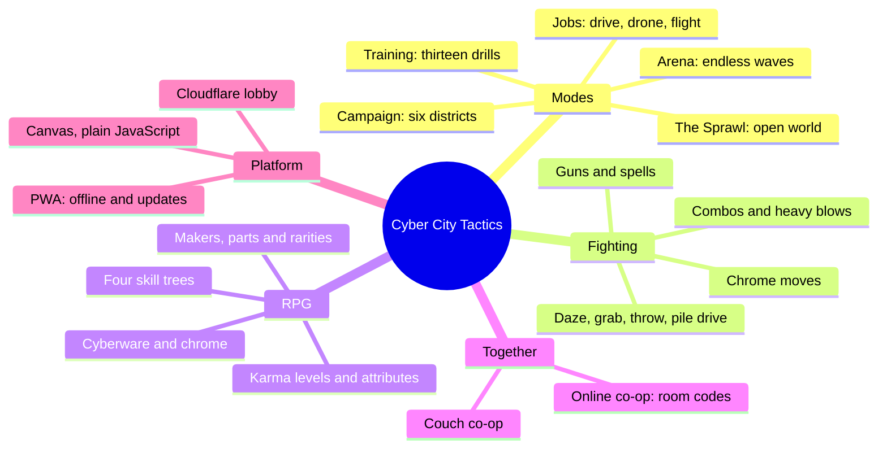

# Cyber City Tactics wiki

A neon brawler RPG for one or two players, couch or online, that runs in any browser and installs as an offline app. This wiki explains how the game plays, how the code is put together, and how to change it safely. Every data table here is generated from the game's own code, so it matches the build it was made from.

**Play:** https://cptnope.github.io/Cyber-City-Tactics/ · **Code:** https://github.com/CptNope/Cyber-City-Tactics

## Pages

| Page | What's in it |
|---|---|
| [[Architecture]] | Folder layout, load order, the frame loop, where state lives |
| [[Game Modes]] | How the title, campaign, Sprawl, Arena, jobs and training connect |
| [[Combat]] | Runner states, the hit pipeline, dazes and the grab menu, chrome moves |
| [[Enemies]] | Every foe with its numbers and behaviours, elites, difficulty and scaling |
| [[Gear and Loot]] | Makers, parts, rarities, weapons, guns, armor, legendaries, crafting |
| [[Runners and Progression]] | Archetypes, attributes, karma, skill trees, cyberware, chrome, spells |
| [[Campaign]] | Districts, bosses, contracts, the Den, side jobs, choices |
| [[The Sprawl]] | Buildings, heat and cred, block events |
| [[Jobs]] | Driving, drone stealth (and overwatch), flight and the rooftop brawl |
| [[Online Co-op]] | The lobby, WebRTC, snapshots and the message protocol |
| [[Saves and Data]] | Every storage key, save shapes and migrations |
| [[Balancing]] | The formulas: enemy scaling, armor, crits, rarity |
| [[Testing and CI]] | Every test file, the bots, CI and deploys |
| [[Robustness Audit]] | The November 2026 audit: findings and fixes |
| [[Contributing]] | Recipes for adding foes, gear, moves, drills and modes |
