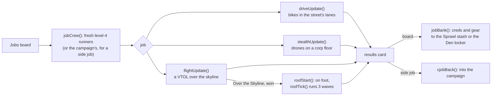

# Jobs

Jobs are standalone runs that aren't a brawl, played from the **Jobs** board on the title or the online hub, or as Juno's side job in the campaign. While a job runs, `update()` hands each step to the job's own function, and `curS()` returns the job's stage. `resetWorld()` clears every job flag, so other modes start clean.

## Driving

Each runner rides a bike in the street's lanes. Hold right to throttle, left to brake, up and down to change lanes, dodge for nitro, jump over oil. Punch and kick riders on either side, shoot and cast either way, and grab loot off the road. The Kagemori Interceptor rams on the last stretch.

| Driving job | District look | Time limit | Pay | Karma | Brief |
|---|---|---|---|---|---|
| The Causeway Run | Rustline Barrens | 110 s | ¥260 | 120 | Get Juno's package across the bridge before Kagemori shuts it |
| Neon Market Getaway | Neon Market | 95 s | ¥340 | 160 | Out through the market with half the Rustline crews behind you |

## Drone stealth

Fly a drone through a corp floor seen in cross-section. Cameras sweep, guards see ahead of them, walls only open at their vents, and lasers blink on and off. Being seen fills a meter; a full meter raises the alarm, and three alarms lock the floor down. Fly to the terminal (an arrow and the distance point the way), drop low and punch to hack it, then fly out through the exit vent, which unlocks once you have the files. Kick fires a shock dart at the nearest guard in reach: from behind it drops them, and from the front it just gives you away. Darting the target pays a bonus. Getting out with no alarms ghosts the job.

**Overwatch co-op:** runner 2 stays off the floor with a reticle. Punch loops the camera or laser under it for seven seconds, and kick pings a noise that pulls nearby guards over. Overwatch starts with three loops and three pings, and gets a loop back (up to five) for every guard the drone drops.

| Drone job | District | Cameras | Guards | Lasers | Walls | Target | Pay | Karma |
|---|---|---|---|---|---|---|---|---|
| Ghost in the Arcology | Kagemori Arcology | 6 | 4 | 3 | 4 | Aide Morrow | ¥320 | 150 |
| The Night Clinic | Neon Market | 4 | 3 | 2 | 3 | Doc Varga | ¥240 | 110 |

## Flight

A VTOL run over a city that scrolls by itself. Runner 1 flies: punch for the cannon, spell for a rocket, dodge for a flare (three a flight; it clears incoming missiles). Runner 2 swings and fires the door gun, which fires on its own in solo. Searchlights on the towers lock on and call in flak. The Raijin gunship guards the drop zone. On Over the Skyline the team then drops onto the Arcology roof and fights three waves on foot. Clearing the roof pays a bonus; getting overrun blows the job.

| Flight job | District | Pay | Karma | Rooftop brawl | Brief |
|---|---|---|---|---|---|
| Over the Skyline | Kagemori Arcology | ¥300 | 140 | 3 waves | Fly the team across Kagemori airspace and drop them on the Arcology roof |
| Into the Storm | Rustline Barrens | ¥360 | 170 | — | A night run out of the Barrens through a lightning storm, gunships on your tail |
