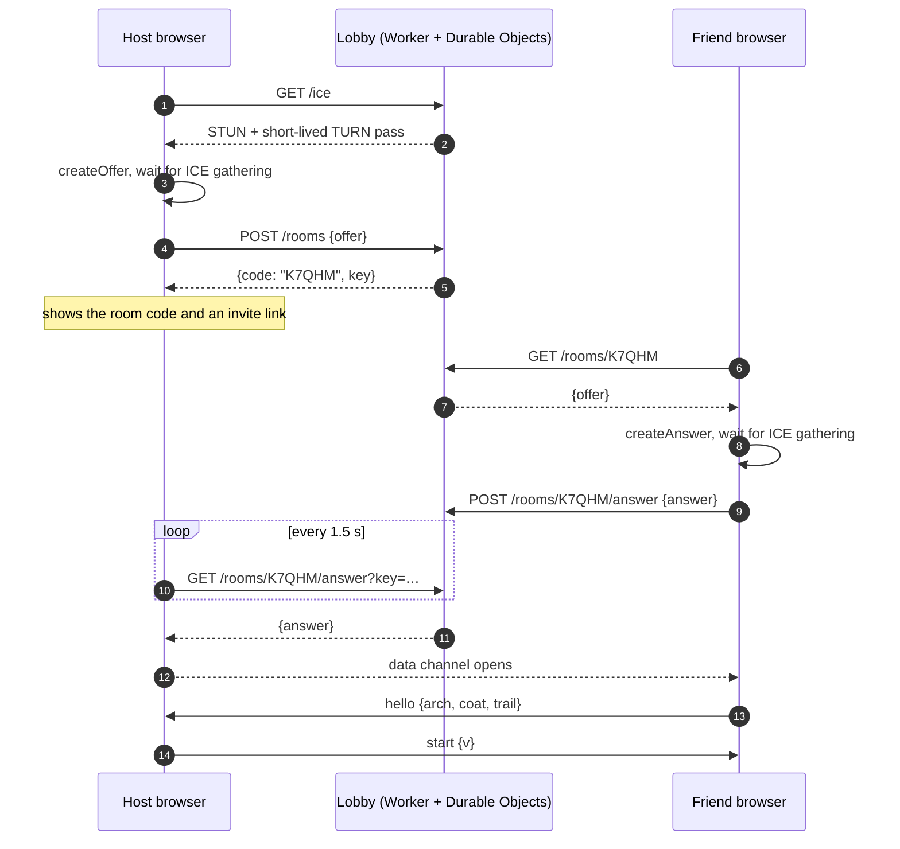
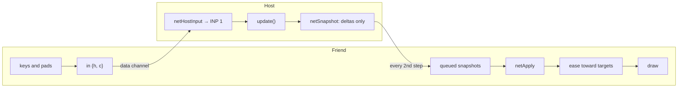
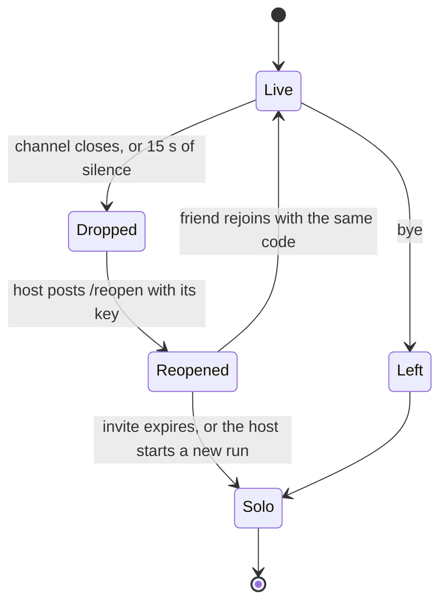

# Online co-op

Two browsers play one game over WebRTC, peer to peer. The host's game is the real one; the friend sends button presses and draws what the host sends back. A small Cloudflare Worker (`server/worker.js`) only swaps the connection details and hands out relay passes. It never sees gameplay.

## Connecting

With `?lobby=off`, or when the lobby can't be reached, the same offer and answer are packed into long `CCT1z…` codes (deflate-raw, base64url) for the players to swap by hand.

## Messages

Every message is JSON with a `k` field.

| `k` | Direction | Contents |
|---|---|---|
| `hello` | friend → host | `arch`, `coat`, `trail`. Accepted once per connection |
| `in` | friend → host | `h`: 13 held flags (`0`/`1`), `c`: a press counter per button |
| `act` | friend → host | `a`: a menu button's action, `m`: the shop the friend is at |
| `full` | friend → host | none: the friend fell behind and wants a fresh picture |
| `start` | host → friend | `v`: the host's version |
| `s` | host → friend | a snapshot: `t`, `hm`, `mu`, `rn`, `hg`, `o`, `pl`, `sx`, `e`, `g`, `pr`, `np`, `nt`, `nf`, plus `pk`, `pp`, `bg`, `pa` when they change and `f:1` on a full resend |
| `bye` | both ways | none: leaving on purpose |

## A frame online

- **Input.** `h` says what is held and `c` counts presses, so a tap shorter than one packet still lands. The friend resends at least every 10 frames.
- **Snapshots.** Every entity gets a stable `nid`. Only fields whose rounded JSON changed are sent (`NET.sent`). References travel as `{$e: nid}` and are resolved on arrival. `G` fields are mirrored except those in `NET_GDENY`.
- **Menus.** The friend's character sheet and shared shops send `act` messages. The host replays them as runner 2 through a hidden button, so they run the same code as a local click.

## What each side checks

| Check | Where | Why |
|---|---|---|
| `in` is 13 `0`/`1` flags plus finite counters for known buttons | `netInOk` | junk can't throw inside the game loop |
| No `in` for 300 ms: let go of the friend's buttons | `netHostInput` | a stalled line doesn't leave runner 2 running into a pit |
| No message for 15 s: the friend is dropped | `netHostTick` | and the room reopens for them |
| One `hello` per connection; arch, coat and trail must be real, unlocked ones | `netRecv`, `netHostBegin` | a second hello can't swap runners mid-run |
| `act` names a real slot, attribute, skill, mod, spell and so on, never `__proto__` | `netActOk` | a crafted click can't reach object prototypes or crash a handler |
| Snapshot keys `__proto__`, `constructor`, `prototype` are skipped | `netApply` | the host can't pollute the friend's objects |
| Backlog over 30 snapshots: discard and ask for `full` | `netRecv`, `netResync` | snapshots are deltas, so a dropped one would leave stale pieces |
| `?lobby=` only reaches our lobby, a `cct-lobby.*.workers.dev` deploy, or localhost | `netLobbyOk` | a shared link can't send invites somewhere else |

## Drops and rejoining

The host keeps runner 2 (`NET.away`) while the room is reopened, so the friend walks back in with the same gear. A failed reopen, or a new run, clears it.

## The lobby

| Endpoint | Does | Limit per address |
|---|---|---|
| `GET /ice` | STUN, plus TURN credentials when the secrets are set | 12 an hour, and 5,000 a day for everyone together |
| `POST /rooms` | stores an invite, returns a code and a key | 20 an hour |
| `GET /rooms/CODE` | the invite | 120 an hour |
| `POST /rooms/CODE/answer` | the reply, once | 30 an hour |
| `GET /rooms/CODE/answer?key=KEY` | the reply, or 204 while waiting; 403 with the wrong key (the reply holds the friend's network address, so only the host reads it) | none (the host polls) |
| `GET /rooms/CODE/answer` (no key, games from before keys) | the same | 2,400 an hour |
| `POST /rooms/CODE/reopen` | a fresh invite under the same code, with the key | shares the rooms limit |

- Invites last 15 minutes. The key lasts four hours, so nobody else can take a code mid-game.
- IPv6 addresses are counted per /64.
- Only pages on `ALLOWED_ORIGINS`, plus localhost, get answers. Bodies are capped at 16 KB.
- Tests: `tests/lobby.test.js` runs the Worker in Node; `tests/online.test.js` connects two Chromium pages for real.
