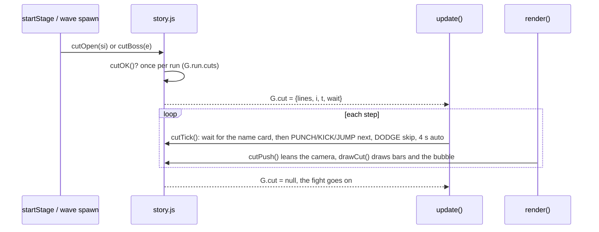
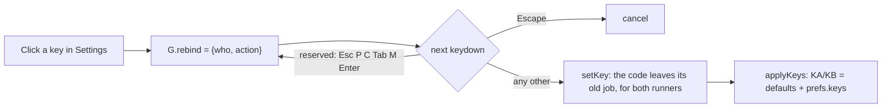

# Presentation and accessibility

## Story scenes

`systems/story.js`. A scene is a short list of lines in `G.cut`; while it's up, `update()` runs `cutTick()` instead of the game, so the street holds still.

| Scene | When | Lines |
|---|---|---|
| District opening | `startStage(si)`, campaign only | Juno over comms, then the runner (`CUTS.open[si]`) |
| Boss arrival | the boss wave spawns | after the `INTRO_LEN` name card: the boss, then the runner (`CUTS.boss[kind]`); rematches skip it |

Rules:
- Scenes play once per run (`G.run.cuts`).
- They don't play in the Arena, the Sprawl, Training, jobs, Juno's side jobs, or on an online friend's screen.
- `resetWorld()` clears a scene, so one never freezes the next scene's street.
- Settings → Story scenes (`prefs.story`) turns them off; the test harness turns them off for every suite except `story.test.js`.

## Music moods

`musicCalmNow()` in core/music.js. A district song (`d0`–`d5`) plays calm (bass, a softer arpeggio, every fourth hat) when no foe is up or a scene is playing, and full otherwise. `M.calm` only changes on step 0 of a bar, so the switch lands on the beat. The boss song is always full.

## Accessibility settings

| Setting | `prefs` | What changes | Where |
|---|---|---|---|
| View | `view`: `3d`, `2d` | street fights in 3D (three.js) or the classic flat view; 3D falls back to 2D without WebGL 2 | render/r3d.js `r3On()` |
| Motion | `motion`: `auto`, `reduced`, `full` | `RM` (no camera push, slides or menu animations); `body.rm` stops CSS animation | `applyPrefs`, game.css |
| High contrast | `contrast` | brighter `--muted` and `--line`, outlined buttons; every canvas word gets a 4.5 px outline | game.css `body.hc`, `txt()` |
| Colour-blind safe | `cb` | `goodCol()`/`badCol()` blue and orange on signs and the minimap, ✓/✕ on sign names, CSS `--ok`/`--neon`, white Leeching (`afxCol`) | render/sprawl.js, game.css `body.cb` |
| Heavy blow | `heavyTap` | two punches within 16 steps start `p.tapCharge`; the next punch releases | `upRunner` |
| Keyboard keys | `keys` | `setKey(who, action, code)` → `applyKeys()` rebuilds `KA`/`KB` from the defaults plus the changes | core/input.js |

The hacking minigame reads whatever key is mapped to punch or jump, so a remap carries into it. Keyboard wording follows a remap too: `ctl()` runs keyboard text through `keyFix()`, which swaps runner 1's default key names (J, K, Space, U, I, O, Q, H, F) for the keys those actions are on now. The help screen's key table goes through the same function.

On touch, a tap anywhere on the screen moves a scene on (`cutTap`), and the hint moves to the top bar, clear of the buttons. With a controller the hint says X and LB.
