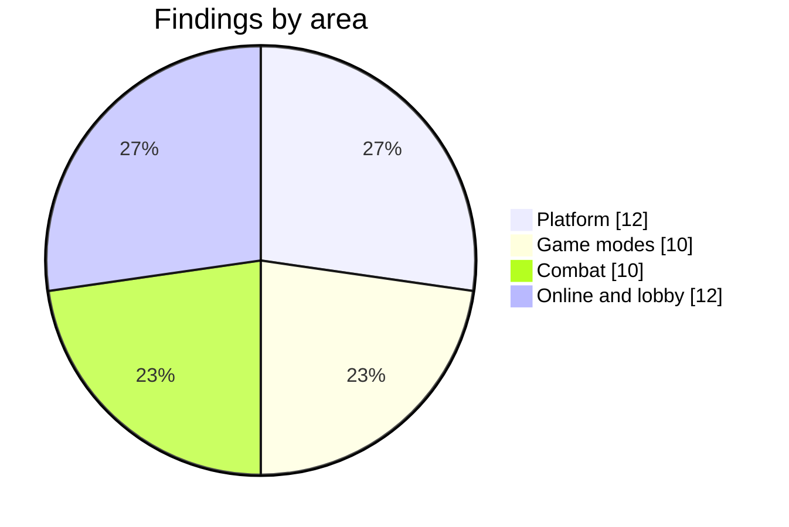

# Robustness audit

A full review of the codebase in four parts: platform (saves, PWA, build, the main loop), game modes, combat, and online play. Each finding was fixed and, where it can be tested headlessly, covered by `tests/robust.test.js`, `tests/lobby.test.js` or an existing suite.

## Platform

| # | Severity | Finding | Fix |
|---|---|---|---|
| P1 | High | A campaign save with an unknown difficulty made the title screen throw, so the game never booted again | `diffOk` in the save shape; `DIFF[...] \|\| DIFF[1]` on the title |
| P2 | High | A Sprawl save without `looted`, `heat`, `rep` or `fac` froze the street | `loadWorld` defaults and type checks |
| P3 | Medium | `runners: [null]`, `attr: null` or `eq: null` crashed Continue | `runnerOk` in both shapes; one `restoreRunner` helper |
| P4 | Medium | An Arena record without `diff` or `score` crashed the Arena screen | numeric `score` and `wave` required; `DIFF` fallback |
| P5 | Medium | Only the first loop error was logged; a repeating one froze the game silently | errors are counted, `acc` reset, and after 120 in a row a card offers a reload |
| P6 | Medium | Saves failed silently when storage was full; a failed import wiped saves | `store.set` returns false and `saveWarn` says so; import writes first, deletes leftovers after |
| P7 | Medium | An item with a maker but no `parts` crashed the gear code | `fixItem` checks both and drops unknown parts |
| P8 | Medium | Files outside the precache list were cached forever | versioned `cct-runtime-…` cache, old ones deleted on activate |
| P9 | Low | A legend whose `runs` wasn't a list threw at the end of every run | type check on load |
| P10 | Low | "Update" did nothing when another tab had already activated the new worker | reload when the waiting worker isn't `installed` |
| P11 | Low | iOS left sound off after a call (`interrupted` state) | resume whenever not running, and on `visibilitychange` |
| P12 | Low | The build silently skipped `defer` scripts and double-quoted font URLs | looser patterns; the build fails if script counts don't match |

## Game modes

| # | Severity | Finding | Fix |
|---|---|---|---|
| M1 | High | "Not yet" at a briefing skipped a whole district | the briefing remembers `G.preBriefStage`; "Not yet" restores it and saves |
| M2 | High | Unequipping during Juno's side job duplicated the item | equip, unequip and drop are blocked with a note while `G.cjob` |
| M3 | Medium | Dropping runner 2 while runner 1 was out left the game stuck | `dropRunner2` releases holds and ends the run |
| M4 | Medium | A runner with 0 lives started the side-job roof brawl one hit from failing | the job crew gets full lives |
| M5 | Medium | Kill karma on the side-job roof was thrown away | kills pay `jobKarma` during a side job |
| M6 | Medium | Campaign mutators carried into Jobs-board runs | the board clears `G.muts` |
| M7 | Low–med | Training left `G.training` on, dodging One Life | `newRun` and briefings switch it off |
| M8 | Low | The stealth terminal's hack card said "undefined", and backing off avoided the penalty | the terminal gets a name and tier; backing off a vault or terminal fails the hack |
| M9 | Low | The daily challenge permanently changed runner 1's class | the challenge class applies only to that run |
| M10 | Note | Quitting mid-building in the Sprawl allowed re-entering to farm rooms | Fixed later in the living Sprawl: buildings remember the room you left (`w.prog`) |

## Combat

| # | Severity | Finding | Fix |
|---|---|---|---|
| C1 | Med–high | Haul-up, hit, haul-up again locked any regular foe forever | `e.hauled`: once per knockdown, reset when they stand |
| C2 | Medium | Grace after a grab finisher froze while the foe was down, so follow-ups missed | grace counts down while down or hurt |
| C3 | Medium | Swift rifles fired 3 rounds instead of 4 | the fire frames scale with the gun's speed |
| C4 | Low–med | A foe stayed upside down after an interrupted pile driver | `flip` cleared on release, on kill and on the early return |
| C5 | Low–med | Rerolling a Street item raised its rarity cheaply | reroll needs at least one part and keeps the count |
| C6 | Low | Legendary prices disagreed (4× vs 6.8×) | one formula in `applyParts`: 4× |
| C7 | Low | Old saves gained a rarity tier from their affix | an old Street item keeps its affix as a legacy mod instead |
| C8 | Low | Landing and burn kills were credited wrongly | `landDir` kept, the thrower credited; `burnSrc` credits the caster |
| C9 | Low | The hammer's ground pound knocked down mech walkers | heavies excluded |
| C10 | Low | Delayed hits from one scene landed in the next | `resetWorld` clears `LATER`; `dropRunner2` releases holders |

## Online and lobby

| # | Finding | Fix |
|---|---|---|
| O1 | A malformed `in` packet could throw in the host's loop | `netInOk` |
| O2 | `act` could name `__proto__` and push `Object.prototype` into the bag | `netActOk` with own-property checks |
| O3 | Unknown gun mods or cyberware in `act` crashed the handler | the same table checks |
| O4 | The friend dropped old snapshots, which are deltas | discard and ask the host for a `full` resend |
| O5 | A second `hello` could swap runner 2 mid-run, or pick locked looks | once per connection; own-property and unlock checks |
| O6 | Codes could be guessed by hammering lookups | 120 lookups and 30 replies an hour per address |
| O7 | Someone could take a code once its invite expired | the host's key is held for four hours |
| O8 | IPv6 users could dodge limits by changing the low bits | buckets per /64; a daily cap on relay passes overall |
| O9 | Runner 2 dropping while held kept the holder kneeing nobody | covered by M3 and C10 |
| O10 | A stalled line kept runner 2's buttons held | released after 300 ms; the host drops a friend after 15 s |
| O11 | A failed reopen left a stale room code and runner | `netFail` and new runs clear them |
| O12 | Snapshot keys could reach prototypes; `?lobby=` could point anywhere | `__proto__`-style keys skipped; `netLobbyOk` allowlist |
