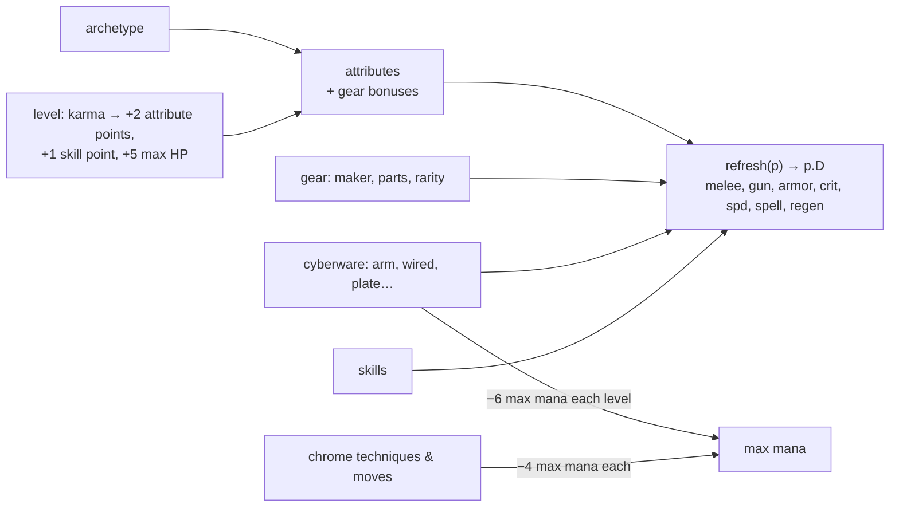

# Runners and progression

A runner is an archetype, five attributes, a level, skills, gear, cyberware, chrome and spells. `refresh(p)` (game/state.js) turns all of that into the derived stats in `p.D` (melee, gun, armor, crit, speed, spell power, regen), plus `maxHp` and `maxMp`.

## Archetypes

| Archetype | Description | Special | Unlock |
|---|---|---|---|
| Street Runner | Balanced at everything. | Adrenaline | open |
| Street Samurai | Chrome and steel. Starts with a katana and a cyberarm. | Blade Dance | open |
| Combat Mage | Fragile but devastating. Knows Fireball and Manabolt. | Mana Storm | open |
| Shaman | Talks to spirits. Knows Fireball and Heal. | Spirit Call | feat: lore10 |
| Rigger | Drones are family. Machine pistol and Hacking 3. | Drone Swarm | feat: cour3 |
| Decker | A hacker who fights dirty. Hacking 5, a smartgun and Port Scanner. | Overload | feat: h10 |
| Gunslinger | Fast hands. Heavy pistol and double ammo. | Bullet Time | open |
| Street Doc | Patches people up between punches. Every melee hit heals you, and a partner close by. Knows Heal. | Triage | feat: coopwin |
| Physical Adept | Magic turned inward. Never uses guns: fists hit 30% harder, and every uppercut throws a chi blast. | Killing Hands | feat: knuckles |

## Attributes

| Key | Attribute | What it does |
|---|---|---|
| bod | Body | Max HP and armor |
| str | Strength | Punch, kick, grab and throw damage |
| agi | Agility | Speed, gun damage, crits |
| mag | Magic | Mana, spell power, regen |
| hak | Hacking | Wider windows when cracking locks in the Sprawl |

## Karma and levels

Karma comes from takedowns, contracts, bosses and jobs, scaled by difficulty, mutators and combo. In co-op each runner gets 75% of it. Level *L* needs `50 + 45 × L` karma to reach the next. Every level gives two attribute points, one skill point, five max HP and some healing.

## Skill trees

Five trees with rows of skills and a capstone. Each archetype starts with its own skill.

| Tree | Row | Skill | Effect |
|---|---|---|---|
| brawler | 0 | Iron Fists | +20% melee damage. |
| brawler | 1 | Guard Breaker | Punches and uppercuts break riot shields, like kicks do. |
| brawler | 1 | Brute | Everything you do to a grabbed foe deals 50% more damage: punches, knees, throws, slams and pile drivers. |
| brawler | 2 | Bloodlust | Melee hits heal you for 2 HP, or 4 HP on a crit. |
| brawler | 2 | Whirlwind | Heavy blows hit enemies behind you too. |
| brawler | 3 | Berserker | Below 40% HP you deal 40% more damage and take 20% less. |
| decker | 0 | Port Scanner | Hacking windows are 25% wider. |
| decker | 1 | Spare Cycles | One extra miss allowed on every hack. |
| decker | 1 | Icecraft | 30% chance an icebreaker is not used up. Caches drop more of them. |
| decker | 2 | Jammer | Drones and ICE take double damage from you. Cops show up 30% less often. |
| decker | 2 | Fence Contacts | Sell gear for 15% more and buy for 10% less. |
| decker | 3 | Ghost Protocol | Failed hacks never trip alarms, and break-ins add one less heat star. |
| gunner | 0 | Steady Hands | +20% gun damage. |
| gunner | 1 | Scavenger | Enemies you kill have a 35% chance to drop 4 rounds straight into your gun. |
| gunner | 1 | Quickdraw | Guns fire 30% faster. |
| gunner | 2 | Armor Piercing | Bullets pass through the first target and ignore armored elites. |
| gunner | 2 | Ricochet | Critical bullets bounce to a second enemy for half damage. |
| gunner | 3 | Deadeye | +15% crit chance with guns, and gun crits deal 2.5× instead of 1.8×. |
| mage | 0 | Focus | +20% spell damage, healing and barrier strength. |
| mage | 1 | Mana Flow | Mana regenerates 40% faster. |
| mage | 1 | Thrift | Spells cost 25% less mana. |
| mage | 2 | Overcharge | Fireball blasts are 60% wider. |
| mage | 2 | Siphon | Every kill restores 4 mana. |
| mage | 3 | Archon | Every fourth spell is free and hits twice as hard. |
| shaman | 0 | Spirit Kin | Companions and summons (yours and the party’s) deal 25% more damage and take 20% less. |
| shaman | 1 | Hex | Your melee hits curse a foe for 4 seconds. Cursed foes take 15% more damage from everyone. |
| shaman | 1 | Ward Totem | Using a medkit also plants a small totem that heals anyone beside it for 8 seconds. |
| shaman | 2 | Wild Call | Your kills have a 15% chance to call a fire spirit to your side for 10 seconds. |
| shaman | 2 | Withering | Your curses also make foes deal 25% less damage while they last. |
| shaman | 3 | Spirit Walk | While a companion or summon fights beside you, take 20% less damage and regain mana 50% faster. |

Shaman mechanics: a curse is `e.curseT` (and `e.curseW` for Withering), applied in `hurt()`; totems live in `G.totems` (`plantTotem`, `totemTick` in game/combat.js) and pulse once a second; `kinMul()` in game/allies.js scales companion hits.

## Active skills

Three points in a tree (`ACTIVE_NEED`) unlock its active skill (`ACTIVES` in systems/skills.js). `p.spSel` (saved with the runner) picks what the ★ button does; `spKey(p)` falls back to the archetype's special when the pick isn't unlocked. `doSpecial()` hands active skills to `doActive()`, and each spends the full meter like a special.

| Tree | Active | Effect |
|---|---|---|
| Brawler | Ground Slam | hop, `kd` everyone within 44 px, and a `wave` projectile each way for 14 + 1.2 × melee |
| Gunslinger | Fan the Hammer | six bullets across the lanes at gun damage, no ammo spent |
| Mage | Summon Spirit | `spawnSummon('ember', p, 900)`: a fire spirit for 15 s |
| Shaman | Totem | `plantTotem(p, true)`: 12 s; each second heals runners within 60 px for 4% max HP and curses foes within 70 px |
| Decker | Short Circuit | every `isTech` foe on screen gets `stunT = 180` (frozen) and a zap of 12 + 5 × Hacking (which includes the deck) |

## Cyberware

| Cyberware | Where | Max level | Effect |
|---|---|---|---|
| Cyberarm tune-up | Doc | 3 | +3 melee damage. |
| Wired reflexes | Doc | 3 | Faster movement, +4% crit chance. |
| Dermal plating | Doc | 3 | +3 armor. |
| Thermographic eyes | Sprawl clinics | 1 | +8% crit chance, and cloaked Kagemori shadows show up clearly. |
| Reflex booster | Sprawl clinics | 1 | Your parry window is nearly twice as wide. |

## Chrome techniques and moves

| Chrome | Kind | Price | Effect | Known already by |
|---|---|---|---|---|
| Servo knuckles | Technique | ¥260 | Punches and uppercuts recover a third faster, and the combo window stays open longer. |  |
| Piston shins | Technique | ¥280 | Kicks recover a third faster and knock foes further back. |  |
| Grip actuators | Technique | ¥300 | Foes you daze stay dazed almost twice as long, you hold a grab longer, and grab punches and knees hit 40% harder. |  |
| Gyro spine | Technique | ¥340 | Throws fly further and hit twice as hard, both on landing and on anyone in the way; body slams, pile drivers and Grand slam hit 50% harder. |  |
| Spring tendons | Technique | ¥300 | Jump higher, and one flying kick can hit twice. |  |
| Recoil dampers | Technique | ¥240 | Back on your feet twice as fast after a knockdown. |  |
| Mach fists | Move | ¥420 | Your third quick punch becomes a flurry of jabs. Keep mashing PUNCH to keep it going; it ends in an uppercut. |  |
| Dragon feet | Move | ¥440 | Your third quick kick becomes a flurry of kicks. Keep mashing KICK to keep it going; it ends with a big kick. |  |
| Grand slam | Move | ¥480 | While holding a grabbed foe, press DODGE to swing them round through everyone close, then hurl them. |  |
| Pile driver rig | Move | ¥460 | Leap with a grabbed foe (JUMP) and land without pushing a direction: a pile driver, head-first into the street, with a shockwave. Street samurai and adepts already know it. | street samurai, adepts |
| Heel spikes | Move | ¥360 | KICK next to a foe on the ground to stomp them. |  |
| Turbo calves | Move | ¥400 | Tap a direction twice to sprint. PUNCH out of a sprint for a shoulder charge, KICK for a slide. |  |

## Spells

| Spell | Mana | Magic needed | Price | Where | Effect |
|---|---|---|---|---|---|
| Fireball | 20 | 0 | starter | Old Wen | Explodes on contact and knocks down everything nearby. |
| Manabolt | 10 | 3 | ¥140 | Old Wen | A fast bolt of raw mana. Cheap and hard-hitting, one target. |
| Heal | 24 | 4 | ¥200 | Old Wen | Restores HP to you and anyone standing close. Scales with Magic. |
| Barrier | 18 | 2 | ¥160 | Old Wen | A mana shield that soaks damage for six seconds. Stronger with Magic. |
| Chain Lightning | 22 | 4 | ¥240 | Old Wen | Arcs through up to three enemies in front of you. |
| Frost Nova | 26 | 5 | ¥380 | talisman shops | A ring of ice around you: damages everything close and slows every enemy for three seconds. |
| Soul Drain | 16 | 4 | ¥320 | talisman shops | A dark bolt that heals you for half the damage it deals. |
