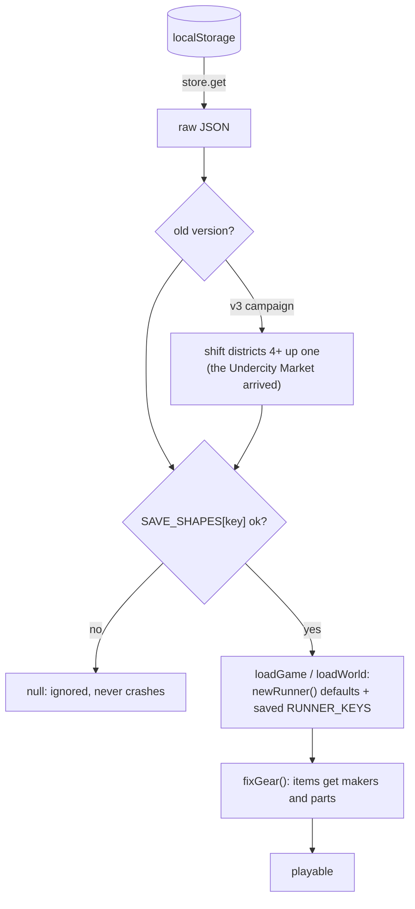

# Saves and data

Everything is stored in the browser's `localStorage` under `cs_*` keys, through `store` in core/utils.js. `store.load(key)` reads a slot **and checks its shape** against `SAVE_SHAPES`, returning `null` for anything malformed, so an old, partial or hand-edited save is ignored instead of crashing a menu. Settings can export every key to a backup file and import it again (pwa.js).

| Key | What | Written by | Read by |
|---|---|---|---|
| `cs_save3` | The campaign: stage, phase (Den or briefing), difficulty, NG+, mutators, party, runners, shop stock, debrief, choices, side jobs | `saveGame()` | `loadGame()`, Continue |
| `cs_world` | The Sprawl: block, heat, cred, faction standing, party, runners, stock | `saveWorld()` | `loadWorld()` |
| `cs_legend` | Your legend: feats, stats, legendaries found, lore, bestiary, run history | `saveLeg()` | boot |
| `cs_prefs` | Settings, seen tips, training done | `savePrefs()` | boot |
| `cs_arena` | Arena high scores (top 8) | `arenaOver()` | Arena screens |
| `cs_day`, `cs_week` | Daily and weekly challenge progress and streaks | challenge end | challenge screens |
| `cs_drive`, `cs_stealth`, `cs_flight` | Job records: best times, ghosts, hull | job results | Jobs board |

## What a runner saves

`RUNNER_KEYS` (game/state.js) lists the fields copied in and out: archetype, level, karma, points, attributes, cyberware `cy`, chrome `tech`, equipment `eq`, spells, HP and mana, ammo, lives, skills `sk`, skill points and coat. On load, each runner is rebuilt from `newRunner()` defaults, then the saved fields are laid over it, so a field added later always has a default.

## Migrations so far

| Change | Handled by |
|---|---|
| District 4 (the Undercity Market) inserted | `store.load` shifts v3 campaign stages ≥ 3 up one |
| Skill trees added | runners without `sk` get fresh skills |
| Chrome (`p.tech`) added | `loadGame` resets a non-object to `{}` |
| Side jobs (`G.sideJobs`) added | `loadGame` resets a non-object to `{}` |
| Makers and parts on items | `fixItem()` / `fixGear()` |

See [[Robustness Audit]] for the save-handling fixes made in November 2026.
