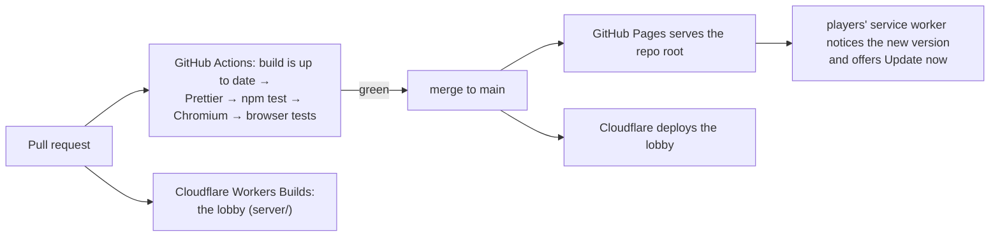

# Testing and CI

Every test loads the real game scripts. Headless tests run in Node with a stubbed DOM (`tests/harness.js`) and drive the game with key presses and menu clicks. Browser tests use Playwright and real Chromium.

| Command | What it does |
|---|---|
| `npm test` | Every headless test, including two bot playthroughs |
| `npm run test:quick` | The same without the bots |
| `npm run test:browser` | Both builds boot, the manifest, shortcuts, offline play, the update flow, and online co-op between two real pages |
| `npm run build` / `npm run check` | Stamp the version and refresh the precache list and single-file build / fail if that's out of date |

| File | Runs in | Min passes | What it covers |
|---|---|---|---|
| `arena-bot.test.js` | headless |  | Bot plays the Arena until it falls; checks waves, perks and scoring. |
| `balance.test.js` | headless | 4 | Foes scale with the party's level as well as the district; jobs keep their own tuning. |
| `blackmarket.test.js` | headless | 9 | Sable, the black-market trader. |
| `browser.test.js` | browser |  | Browser checks with Playwright (npm i -D playwright, then npm run test:browser). |
| `campaign-bot.test.js` | headless |  | Bot plays the whole campaign on Runner difficulty and should win. |
| `choices.test.js` | headless | 17 | Choices that change the campaign. |
| `chrome.test.js` | headless | 36 | Grabs and chrome techniques. |
| `companions.test.js` | headless |  | Hired companions and the Barrier and Chain Lightning spells. |
| `content.test.js` | headless | 37 | Shaman and Rigger, summons, mutators, coats, block events, the Lantern Vault, run history, the rename. |
| `drive.test.js` | headless | 36 | Driving missions (modes/drive.js). |
| `expansion.test.js` | headless | 155 | Mutators (Turbo, Fog, Split, Pacifist), block events (acid rain, corp parade, manhunt), Doc's neural reset and co-op revive. |
| `flight.test.js` | headless | 34 | Flight jobs (modes/flight.js). |
| `gear.test.js` | headless | 20 | Borderlands-style gear. |
| `grabs.test.js` | headless | 22 | Double Dragon grabs. |
| `graphics.test.js` | headless | 38 | Drawing rules that are easy to break and hard to spot. |
| `legend.test.js` | headless | 41 | Feats, legendaries, the Codex, lore, Decker unlock, bounties, hidden doors, couriers, daily challenge. |
| `lobby.test.js` | headless | 39 | The online lobby Worker (server/worker.js), run in Node with an in-memory Durable Object stand-in. |
| `livingsprawl.test.js` | headless | 32 | Day and night, the block’s memory of what you did, buildings that remember the room you left, sentry turrets and hacking in a fight. |
| `market.test.js` | headless | 15 | District 4, the Undercity Market. |
| `mastery.test.js` | headless | 19 | Archetype mastery: the tiers, the growing numbers, and every archetype's tier III twist. |
| `hackgames.test.js` | headless | 28 | The newer locks: which building gets which, Sequence, Trace and Firewall wins, misses and lockouts, icebreakers, Port Scanner, and the card. |
| `mechanics.test.js` | headless |  | Core combat mechanics. |
| `online.test.js` | browser |  | Online co-op in a real Chromium. |
| `pwa.test.js` | headless | 12 | PWA helpers that don't need a real browser. |
| `robust.test.js` | headless | 34 | The audit fixes: corrupt saves, "Not yet", side-job gear lock, haul once per knockdown, runner 2 drops, online message checks. |
| `screen.test.js` | headless | 20 | Full-screen fitting on every screen shape, and every campaign district still playable at every view width (wave triggers must stay reachable when the view is wider than 480). |
| `sets.test.js` | headless | 29 | Maker sets, cyberdecks and the four active skills, and saving the deck and the ★ choice. |
| `shaman.test.js` | headless | 20 | The Shaman tree: hexes, withering, spirit kin, ward totems and the Totem, the wild call and the spirit walk. |
| `shop.test.js` | headless | 41 | The bigger party bag and selling gear at every store counter. |
| `sidejob.test.js` | headless | 18 | Juno's side jobs in the campaign (modes/jobs.js). |
| `skills-gear.test.js` | headless | 35 | Skill trees, new weapons and armor, affixes, and save migration. |
| `specials.test.js` | headless |  | Archetype specials, vending machines, data nodes, Glitch splitting, Black ICE beams. |
| `sprawl-coop.test.js` | headless | 5 | Two runners clear a Sprawl building together (bot; can occasionally lose a fight). |
| `sprawl.test.js` | headless | 28 | The Sprawl. |
| `stealth.test.js` | headless | 46 | Drone stealth jobs (modes/stealth.js). |
| `story.test.js` | headless | 42 | Story scenes (open, boss, skip, once per run), music moods, motion, contrast and colour-blind settings, key remapping and the double-tap heavy blow. |
| `streetfights.test.js` | headless | 33 | Street weapons, foes who carry and fetch them, wall bounces and juggles, mercy, runners and boss taunts. |
| `streetfoes.test.js` | headless | 17 | Foes who fight like the runners. |
| `timing.test.js` | headless | 27 | The frame loop. |
| `training.test.js` | headless |  | Bot completes all fourteen training drills; boss rematches spawn. |
| `weekly.test.js` | headless |  | Weekly challenge seeding, modifiers and the share line. |

## CI and deploys

`main` is protected: changes go through a pull request. The harness exposes any game global as `__api.name`, and `__G`, `__PL()` and `__PARTY` for state. `step(n)`, `key(code, down)`, `tap(code)` and `click(action)` drive it.

Tips for writing tests:
- Hold a key for a few steps rather than `tap()` when a press must not fall between two logic steps.
- Release keys a previous section left held.
- Clear foes and release grabs between sections.
- Set `prefs.tips = false` and `prefs.seen.trainoffer = true` so tips and the training offer don't get in the way.
