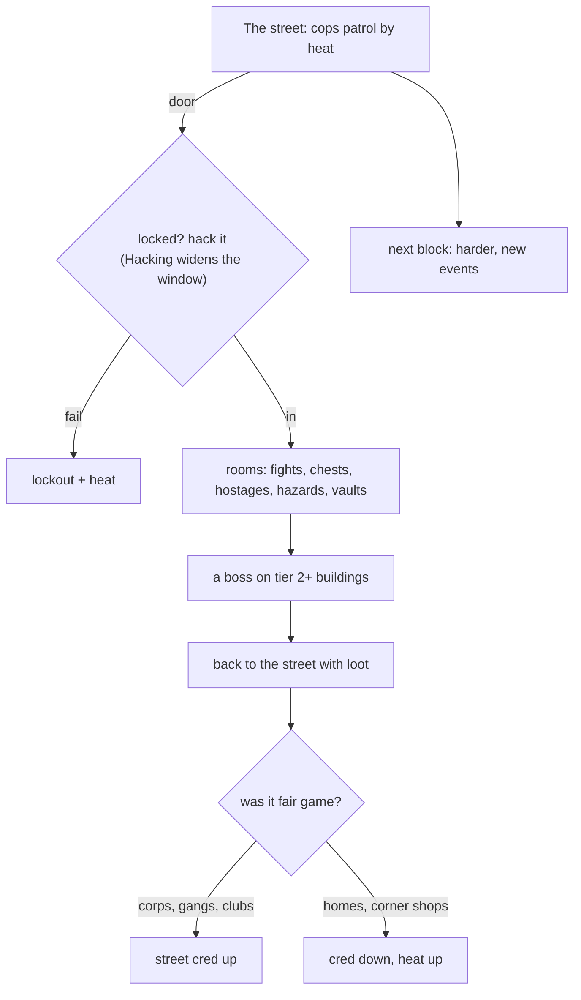

# The Sprawl

An open-world street of doors to crack, one block at a time (`G.world`, `G.wd`). Each block is generated from its level and a seed (`genStreet()`), so a shared seed rebuilds the same block.

## Buildings

"Fair game" is what `isGood()` returns for the building type. A Lone Star precinct counts as good only once your street cred reaches +30, and dirty businesses only once they're revealed.

| Building type | Ethics | Usual foes | Tier-3 extras | Bosses by tier |
|---|---|---|---|---|
| hideout | fair game | Ganger, Orc bruiser, Street shaman | Ghoul, Riot trooper, Hellhound | Crew lieutenant / Crew boss / Crew warlord |
| blacksite | fair game | Corp security, Riot trooper, Drone | ICE sentry, Glitch, Kagemori shadow, Kagemori mech walker | Site chief / Research director / Vault ICE |
| business | off limits | Corp security, Drone | Riot trooper | Head of security / Head of security |
| home | off limits |  |  |  |
| club | fair game | Ganger, Orc bruiser | Street shaman, Hellhound | Head bouncer / Head bouncer / Club owner |
| precinct | off limits | Patrol officer, Drone, Riot trooper | Riot trooper, Corp security | Watch commander / Watch commander / Watch commander |
| dirty | off limits | Corp security, Orc bruiser, Ganger | Riot trooper | Bodyguard / Bodyguard / Bodyguard |
| secret | fair game | Street shaman, Ghoul, Fire spirit, Feral spirit | Glitch | Lantern keeper / Lantern keeper / Wyrm priest |

## Block events

| Key | Block event | What happens |
|---|---|---|
| gangwar | Gang war | The crews are fighting over the block. Patrols come twice as often and hideouts pay double street cred. |
| blackout | Blackout | The grid is down. No cops can find you, locks are easier to crack, and it is very dark. |
| lockdown | Kagemori lockdown | Every black site is locked at tier 3 with better loot, and heat cools half as fast. |
| festival | Night market | Lantern festival on the block. Shops are 20% cheaper and vending machines line the street. |
| acidrain | Acid rain | Toxic rain eats at everyone out on the street, gangers included: 1 HP every two seconds. Indoors is dry. |
| parade | Corp parade | Kagemori is celebrating. Patrols walk the block even with no heat, but every takedown pays 50% more creds. |
| spiritstorm | Spirit storm | The astral is boiling over. Wild spirits drift down the block, and every spell costs half the mana. |
| manhunt | Manhunt | Someone put a price on your head. Bounty hunters come for you now and then, and each one carries a fat payout. |

Also on the street: heat (0–5 stars; cops, then drones and riot cops), street cred, Sable's black-market cart, Juno's bounty building, Kagemori courier drones, hidden doors, and the Lantern Vault once all 24 lore shards are found.
